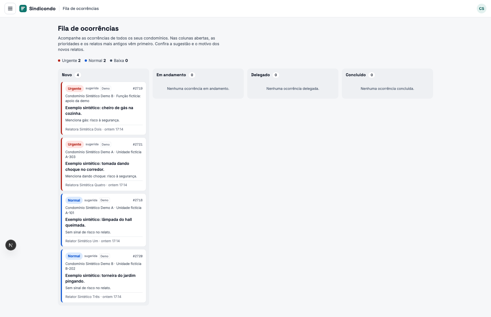

# Zelo

Development foundation using Next.js 16.4.6 (App Router), React 19.3.0, TypeScript and Tailwind CSS 4.3.3. The generated application remains unchanged; no business features are implemented.

## Local setup

Use Node.js 24 and npm. `.nvmrc` pins Node.js 24.22.3. With nvm installed:

```bash
nvm install
nvm use
npm ci
npm run dev
```

Open http://localhost:3000. Application files are in `src/app`, and static assets are in `public`. The current homepage runs without environment configuration; Supabase factories require the local values described below when called. Local `.env*` files are ignored; `.env.example` is allowed for future documented sample values. Never commit credentials or real personal data.

## Commands

| Command                | Purpose                                                                              |
| ---------------------- | ------------------------------------------------------------------------------------ |
| `npm run dev`          | Start the development server.                                                        |
| `npm run format`       | Format supported repository files with Prettier.                                     |
| `npm run format:check` | Check formatting without writing changes.                                            |
| `npm run lint`         | Run ESLint across the project and reject warnings.                                   |
| `npm run typecheck`    | Generate Next.js route types, then run `tsc --noEmit`; works before the first build. |
| `npm run build`        | Create the production build.                                                         |
| `npm start`            | Serve an existing production build locally.                                          |
| `npm audit --omit=dev` | Audit production dependencies.                                                       |

Run formatting and all quality commands before handing off changes. The current layout uses `next/font/google`; a fresh build requires access to Google Fonts.

## Local Supabase

Install and start Docker Desktop or another Docker-compatible runtime. Run all commands from this repository. The exact-version CLI is a development dependency (`supabase@2.122.1`); npm scripts use it locally. Do not install a global CLI or create a separate Docker Compose stack. No Supabase account, login or linked remote project is needed.

On a fresh clone:

```bash
nvm use
npm ci
docker ps --format '{{.Names}}\t{{.Ports}}'
npm run db:start
npm run db:status
cp .env.example .env.local
```

Inspect existing containers and port usage before starting. The project identifier is `zelo-local`. API uses port 54321, PostgreSQL 54322, Studio 54323 and the email testing UI 54324; shadow database operations use 54320. If any required port is occupied, change this project's configuration rather than stopping another stack. The first start downloads Docker images. Do not bypass startup health checks.

On Docker Desktop, select **Settings → Network → Port binding behavior → Localhost by default** before starting the stack. This is a machine-wide Docker Desktop setting that affects default port publishing for other containers too; it is not a project-only setting. Local startup has been verified on the development host with this prerequisite. The dedicated bridge option alone did not restrict publishing on that host.

`db:start` creates or verifies the dedicated `zelo-local-loopback` Docker bridge and passes it to the CLI. It refuses unrecognized networks, existing Zelo containers on other networks and non-loopback host port bindings. If startup or post-start verification fails, it gracefully stops only running containers with the exact `com.supabase.cli.project=zelo-local` label, preserving volumes and networks. Cleanup failures are reported separately from the original error. Pre-start failures do not stop containers.

After startup, verify actual Docker host port bindings:

```bash
docker ps --filter "name=zelo-local" --format '{{.Names}}\t{{.Ports}}'
```

Every published port must bind exclusively to `127.0.0.1` or `[::1]`. Do not proceed if any binding uses `0.0.0.0` or `[::]`; stop only this project's containers and investigate the Docker Desktop prerequisite. The Supabase CLI may still print its general wildcard-binding warning. That warning alone does not verify actual host exposure; use the Docker port output and the startup safety check. Container-internal listeners and loopback service URLs do not establish host binding safety. Do not expose local Studio or forward these ports to a public network.

After a successful start, inspect `npm run db:status` privately. Copy the API URL into `NEXT_PUBLIC_SUPABASE_URL` and the local **anon** key into `NEXT_PUBLIC_SUPABASE_ANON_KEY` in `.env.local`. This setup uses the CLI's legacy anon key. Never copy a service-role key, secret key, access token, database password or connection string into a `NEXT_PUBLIC_` variable or repository file. Status output includes sensitive values; do not paste it into reports or commits. Restart Next.js after changing environment values.

| Command             | Purpose                                                                                                 |
| ------------------- | ------------------------------------------------------------------------------------------------------- |
| `npm run db:start`  | Start this project's CLI-managed Docker stack and wait for health checks.                               |
| `npm run db:stop`   | Stop this project's stack, preserving local data for the next start.                                    |
| `npm run db:status` | Inspect local service status and connection settings privately.                                         |
| `npm run db:reset`  | Destroy local development data and reapply migrations and seed, explicitly using `--local`.             |
| `npm run db:types`  | Generate public-schema types from the running local database into `src/lib/supabase/database.types.ts`. |

PostgreSQL, the Data API, Auth, Storage, Studio and local email testing are enabled. Realtime, Edge Functions, analytics, the pooler, S3 protocol and vector storage are disabled. Open Studio at http://127.0.0.1:54323 and captured emails at http://127.0.0.1:54324 after startup. Check that `db:start` completes its health checks and that `db:status` shows the enabled services running. Local test emails stay in the local email service.

### Migrations and types

`supabase/migrations` contains the reviewed profile, condominium and confirmation-guard migrations. `supabase/seed.sql` is intentionally empty. Create future reviewed schema changes with:

```bash
npx --no-install supabase migration new describe_change
```

Edit the new SQL migration before applying it, review it, then apply pending migrations locally with `npx --no-install supabase migration up --local`. Never edit an already applied historical migration; add a new migration instead. Keep seed data synthetic and free of credentials and personal data.

Run `npm run db:types` only after the local database is running and after schema changes. Generation captures output before writing, formats it and atomically replaces the destination; a failed generation leaves existing types untouched. No database types are fabricated before generation. Factories are currently schema-agnostic; add the generated `Database` generic when schema-backed application work starts.

`npm run db:reset` is destructive: it destroys local development data and rebuilds the database from migrations and seed. Run it only when you intentionally need a clean local database; it is not a routine validation command. Never add remote targets to this script.

### Client factories and environment boundaries

Import `createClient` from `@/lib/supabase/client` for browser code or from `@/lib/supabase/server` for server code. The server factory is asynchronous, request-scoped and protected by `server-only`. Configuration is validated when a factory is called, not during module import. The existing homepage does not call either factory.

The server factory follows the SSR `getAll`/`setAll` cookie adapter and tolerates read-only Server Component cookie writes. The proxy refreshes sessions and preserves cookie/cache headers. Private pages and APIs must also verify the identity on the server; the factory and proxy alone do not grant access. The confirmation guard uses a server-only privileged RPC request as described below; no privileged browser or admin application client exists.

Local Docker volumes and credentials are independent from any future hosted environments. Local commands do not link remote projects. Only the reviewed deployment job described below may connect to an environment-specific Session pooler and apply versioned migrations. Never use remote reset, remote seed or automatic migration repair.

References: [Supabase local development](https://supabase.com/docs/guides/local-development/cli/getting-started), [CLI configuration](https://supabase.com/docs/guides/local-development/cli/config), and [SSR clients](https://supabase.com/docs/guides/auth/server-side/creating-a-client).

## Testing

Vitest uses jsdom, React Testing Library and jest-dom. Unit/component tests live in `tests/unit/**/*.test.{ts,tsx}` and support the `@/` alias. The homepage smoke test renders the existing synchronous component without Next.js mocks and checks its main heading by accessible role. Async Server Components belong in browser tests.

```bash
npm test
npm run test:watch
```

Install Playwright's Chromium browser once after installing dependencies (and again when the required browser version changes):

```bash
npx playwright install chromium
```

On Linux, browser system dependencies may also be required: `npx playwright install --with-deps chromium`.

```bash
npm run test:e2e
npm run test:e2e:ui
```

Both browser commands build the application first. Playwright discovers only `tests/e2e/**/*.spec.ts`, uses Chromium, and starts and stops the production server at `http://127.0.0.1:3100`. Port 3100 must be free; an existing server is rejected. The tests verify the homepage heading and an unknown route's HTTP 404 response and heading. No external application services or credentials are required.

Failure traces are retained in `test-results`; the HTML report is in `playwright-report`. Both are ignored by Git and Prettier. Open the report with `npx playwright show-report`. Exclusive tests are rejected when `CI` is set. No coverage threshold is configured.

## Continuous integration

`.github/workflows/ci.yml` runs the stable `Quality` job on pull requests targeting `main` or `develop`, pushes to those branches and manual dispatch. It installs dependencies with `npm ci`, then checks formatting, lint, types, unit tests and the production dependency audit (`npm audit --omit=dev --audit-level=moderate`), installs Chromium and runs `test:e2e`, which builds production code before browser tests. No database or Supabase credentials are required.

Failed runs upload only existing Playwright reports and test results, excluding environment files, for three days. Superseded Quality jobs for the same PR or branch are cancelled. PRs and manual dispatch run validations only, without deployment credentials or remote migrations. Pushes to the permanent branches can deploy only after Quality succeeds. Branch protection must be configured separately; remote pipeline execution remains unverified until exercised on GitHub. Use `.github/pull_request_template.md` to describe changes and validation.

## Deployment pipeline

The deployment job in `.github/workflows/ci.yml` runs only for successful `push` validations on the permanent branches:

| Branch    | GitHub Environment | Vercel project | Vercel target |
| --------- | ------------------ | -------------- | ------------- |
| `develop` | `development`      | `zelo-dev`     | Production    |
| `main`    | `production`       | `zelo-prod`    | Production    |

There is no `stage` branch. Keep the existing GitHub Environment branch restrictions: `development` allows only `develop`; `production` allows only `main`. Each environment must have its own configuration and credentials:

| Kind      | Names                                                                           | Purpose                                                                                        |
| --------- | ------------------------------------------------------------------------------- | ---------------------------------------------------------------------------------------------- |
| Variables | `SUPABASE_PROJECT_ID`, `SUPABASE_DB_HOST`, `VERCEL_ORG_ID`, `VERCEL_PROJECT_ID` | Select the matching Supabase project, Session pooler hostname and Vercel organization/project. |
| Secrets   | `SUPABASE_DB_PASSWORD`                                                          | Authenticate migrations against only that environment's Session pooler.                        |
| Secret    | `VERCEL_TOKEN`                                                                  | Pull settings, build and publish only that environment's Vercel project.                       |

The workflow uses the exact locked `vercel@65.16.0` CLI (Node >=20, compatible with Node 24) and `supabase@2.122.1`. It checks out the validated commit and installs with `npm ci`. Vercel settings and environment variables are pulled with `vercel pull --environment=production`, then `vercel build --prod` prepares `.vercel/output` before any remote database operation. Both Vercel projects use Production internally; GitHub's `development` does not mean Vercel Preview.

Because the build runs before migrations, build-time code (including prerendering and static generation) must not query tables or columns created only by those pending migrations. Defer such queries to request time or introduce the schema in an earlier backward-compatible release; do not move migrations ahead of the build to bypass this constraint.

After a successful build, the helper `scripts/deploy-migrations.mjs` uses an explicit `--db-url` for the environment's shared Session pooler: hostname from `SUPABASE_DB_HOST`, port `5432`, database `postgres` and username `postgres.<SUPABASE_PROJECT_ID>`. Set the hostname only, such as the Session pooler host shown in the Supabase Connect panel, without a scheme, credentials, port or path. The helper validates the project reference and `*.pooler.supabase.com` hostname, percent-encodes the raw password exactly once and requires TLS with `sslmode=require`. This mode enforces encryption but does not add CA/hostname verification; certificate-pinned verification would require separate CA configuration.

Both calls use `--dns-resolver https`: the pinned CLI queries Cloudflare DNS-over-HTTPS (default record type A) for IPv4 addresses, avoiding the direct database's IPv6-only endpoint. This adds a dependency on outbound HTTPS access to `1.1.1.1`. The workflow no longer calls `supabase link`, uses `--linked` or needs `SUPABASE_ACCESS_TOKEN`; an existing environment access-token secret can remain unused or be removed after confirming no other workflow needs it.

The helper first invokes `db push --db-url ... --dry-run --skip-vault --yes`, then a separate step invokes the same target without `--dry-run`. It applies only pending versioned migrations: no seed, custom roles, vault updates, reset, automatic history repair or example migrations. It registers GitHub masks for the raw password, encoded password and full URL before starting the CLI. The helper invokes the public `node_modules/.bin/supabase` executable and captures stdout/stderr before logging sanitized connection diagnostics, pending migration listings and success/failure messages. Raw and encoded passwords and PostgreSQL connection URLs are redacted; terminal escape sequences and workflow-command markers are neutralized. Raw subprocess errors are never printed. A failed CLI command preserves its exit code; startup errors or signals fail with code 1. Investigate remaining connection settings privately without enabling credential-bearing logs.

A failure blocks publication. Only after both migration steps succeed does `vercel deploy --prebuilt --prod` publish the prepared output. The deployment job uploads no artifacts and removes `.vercel` and CLI temporary state on exit. These directories and environment files remain ignored.

Vercel Production application settings must match the corresponding Supabase environment, including `NEXT_PUBLIC_SUPABASE_URL` and the public `NEXT_PUBLIC_SUPABASE_ANON_KEY` when clients are used. Do not put the database password or an access token or privileged keys in public variables, Vercel build settings or versioned files. Public Next.js values are embedded at build time; build separately for each project. Never print environment values or enable shell tracing around credentialed commands. Secrets are scoped to the steps that need them, rather than job-wide environment variables.

### Ordering and recovery

A separate concurrency group serializes deployments for each environment with `cancel-in-progress: false`. New pushes do not cancel active migrations or publications. GitHub may replace pending jobs and does not guarantee queue order, so the job verifies that its commit is still the branch HEAD before build, before migrations and before publication. Obsolete or unverifiable runs fail closed, including old reruns. A newer push after the final check may arrive while publication is in flight; its deployment waits for the current job, so this pipeline cannot publish an older run over its already completed newer run. Manual deployments or other workflows do not share this guarantee and must not bypass the pipeline.

There is no transaction spanning Supabase and Vercel. If migrations succeed but publication fails or the commit becomes obsolete, the database may be ahead of the live application. Use backward-compatible expand/contract migrations so the existing app keeps working. Inspect migration history and deployment state privately; fix forward through reviewed migrations and deploy the current branch HEAD. A Vercel rollback does not roll back the database. Do not automatically reverse migrations, reset the remote database, repair history or reapply seed data. Manual cancellation, runner loss and timeouts can also leave partial progress; inspect both systems before retrying. Database backup/restore procedures and post-deploy application health checks remain separate operational work.

### Activation and proof

1. Review the workflow and environment mappings without revealing credentials. Confirm Node 24, the Next.js preset and Production application variables in both Vercel projects. Keep privileged deployment credentials only in their matching GitHub Environment and restrict who can modify protected branches, workflows and environment approvals.
2. Coordinate a transition window before merging this pipeline to `develop`. Pause/disconnect automatic Git deployments for both Vercel projects through their Git integration settings and inspect any already queued Git-triggered deployments. This prevents older branches without the new configuration from publishing during the transition; existing live deployments stay available.
3. `vercel.json` sets `git.deploymentEnabled` to `false` for all branches. It takes effect for Git events whose commit contains the file; it does not change dashboard settings from this working tree or cancel already queued deployments. Carry this configuration through `develop` and `main` before considering the transition complete. Leave automatic Git deployments disabled afterward; CLI deployments remain the publication path.
4. After the reviewed changes reach `develop`, confirm the PR ran Quality only, then confirm its push ran Quality followed by Deploy in `development`, targeting `zelo-dev`. Inspect the build-before-migrations sequence, dry-run, migration history and deployed commit, then open the application's URL and check its heading. Do not invent a migration to exercise the pipeline; an empty pending migration set is valid.
5. Promote through a reviewed PR to `main` and repeat the checks for `production` and `zelo-prod`. Confirm no parallel Git-integration deployment appeared. Check that obsolete reruns are blocked and new pushes do not cancel an active deployment. No remote checks are claimed by local validation.

Renew tokens before expiration and whenever access changes or exposure is suspected. Create replacement credentials with the minimum provider-supported access, update only the matching GitHub Environment secret, verify through an authorized current-HEAD deployment, then revoke the old token. The migration connection uses only the database password; SUPABASE_ACCESS_TOKEN is not consumed by this pipeline. Rotate the remote database password in Supabase and its matching `SUPABASE_DB_PASSWORD` secret in a coordinated window. Do not copy development tokens into production, rotate credentials in repository files or paste values into logs/issues. Provider outages, credential expiry and service authorization failures stop the pipeline and require operator intervention.

References: [Vercel build](https://vercel.com/docs/cli/build), [prebuilt deployments](https://vercel.com/docs/cli/deploy), [Git deployment configuration](https://vercel.com/docs/project-configuration/git-configuration), and [GitHub concurrency](https://docs.github.com/en/actions/how-tos/write-workflows/choose-when-workflows-run/control-workflow-concurrency).

## Conventions

Use English for code, configuration and repository documentation, and Brazilian Portuguese for user-facing interface text. The generated starter text is retained for this foundation step. See AGENTS.md for project and installed Next.js documentation instructions.

The permanent branches `main` and `develop` already exist. Start new task branches from `develop` and submit changes through a PR to `develop`. Promote releases from `develop` to `main` through a reviewed PR.

## Pending setup and known limitations

The deployment pipeline is configured but remote execution and recovery procedures require operational verification. The general Quality job requires no database credentials. Optional local Auth integration and SQL checks are described below; hosted SMTP delivery and provider-wide enforcement remain pending.

The known full dependency audit issue is GHSA-g3hv-75wg-m249 through `@typescript-eslint/typescript-estree` to `minimatch@10.2.6`. The checked `typescript-eslint@8.72.2` still requires `^10.2.2`. The production-only audit is the blocking audit in this initial CI; it does not audit all development dependencies or establish that the complete dependency tree is free of vulnerabilities. No overrides or advisory suppression are configured.

## Signup confirmation integration (ORI-47)

The real flow calls `/api/auth/signup`, `/api/auth/confirm-signup` and
`/api/auth/resend-signup`. Supabase verifies the signup OTP and establishes the
SSR cookie session. The browser checks `/api/auth/session` before navigating to
`/fila`. After successful code verification, temporary session-check failures
can be retried without submitting the consumed code again. The verified session
must match the registration email; an inactive or mismatched session offers login
instead of granting access. Queue access also validates the confirmed identity on the server;
`/api/panel` additionally requires the account's protected `is_sindico` profile
and filters condominium counts by the current identity. Logout uses the real
Supabase session endpoint and refreshes client navigation state. The login form
uses the existing login API and returns to the protected queue. ORI-87 adds
the cookie persistence choice and the separate recovery flow described below.

Panel identity and first steps use the protected API even when development mock
flags are present. Component mocks remain available as explicit test fixtures.
A simulated signup is not an authenticated session and cannot unlock `/fila`.
First steps are shown only in the current post-signup flow. Login, logout and
a fresh page load do not show this card. First-step dismissal affects only the
current rendered panel; per-account
persistence belongs to ORI-48. Only the condominium step can be derived from the
existing database. Employee registration, resident-link delivery, occurrence
history and their navigation destinations remain unavailable.

The implemented confirmation policy is a six-digit, single-use code valid
for 15 minutes, five incorrect application verification attempts followed by a
15-minute block, and at least 60 seconds between sends. A resend must invalidate the previous provider code. The
local Auth configuration requires eight password characters containing an ASCII letter
and a digit. Check the same policy in the hosted project's Auth settings;
repository configuration does not automatically update hosted Auth.

The application guard calls only the `email_confirmation_guard` RPC using a
server-only service-role credential. It does not create an admin browser client
or expose privileged credentials in public variables. Its two existing migrations
must be present before real signup. This key has broader provider privileges than
the RPC needs; keep its use isolated and consider a dedicated restricted backend
credential before expanding this integration. The guard does not prevent direct
calls to Supabase Auth with the public key. Application attempt limits therefore
do not establish global provider enforcement; configure and verify provider rate
limits separately. Do not claim a global five-attempt guarantee.

### Hosted development email setup

In the intended development Supabase project, open Authentication, Email, SMTP
Settings and configure custom SMTP directly in the dashboard:

- Host: `smtp.gmail.com`.
- Port: `465` with implicit TLS, or the provider-supported STARTTLS configuration.
- Username: the full Google account address.
- Password: the Google application password, entered only in the dashboard.
- Sender address: the authorized sending account or verified alias.
- Sender name: `Sindicondo`.

Creating a Google application password does not configure SMTP. Enable email
confirmation and review OTP expiry, password policy and Auth rate limits. Set
Site URL and allowed redirect URLs for the matching application environment.
Use the versioned confirmation template with `{{ .Token }}` for the code flow;
review the recovery template independently. Local templates are not automatically
published to hosted Auth. Keep SMTP passwords out of application environment
variables and repository files.

Application environment names are `NEXT_PUBLIC_SUPABASE_URL`,
`NEXT_PUBLIC_SUPABASE_ANON_KEY` and server-only `SUPABASE_SERVICE_ROLE_KEY`.
Use matching local or development project values. Disable
`NEXT_PUBLIC_REGISTRATION_DEMO` for real signup. Vercel public values require a
rebuild; the development project uses the Production scope in this repository's
deployment pipeline. Do not change hosted settings or deploy without explicit
authorization.

Local end-to-end tests require the CLI-managed `zelo-local` stack, the confirmation
migrations, disabled registration mocks and `ORI47_LOCAL_AUTH_TESTS=enabled`.
They use synthetic accounts and capture codes in local Mailpit. Only that local
suite is allowed to manipulate test records. Do not record credentials, codes or
tokens in screenshots, traces or logs. Captured local mail proves local Auth
integration, not delivery to an external inbox. Hosted delivery acceptance needs
an explicitly authorized test recipient, actual receipt and full confirmation;
a successful signup API response alone is insufficient.

### Validation record

On 2026-11-21, manual validation reported a successful signup using the local
Supabase stack with the temporary Gmail SMTP profile. The confirmation code
arrived in an external inbox, and entering it successfully confirmed the account
and allowed the real flow to continue. This is a manual validation record,
not an automated test result. No recipient address, password, code or token is
recorded here.

This establishes external delivery and successful signup confirmation only.
Incorrect or expired codes, code reuse, resend invalidation, attempt limits,
session persistence after reload, logout and password recovery were not reported
as tested with external SMTP during that signup-only check. The subsequent
ORI-87 recovery acceptance is recorded below. Their existing local automated coverage must not
be presented as external SMTP acceptance. Automated Auth integration tests use
Mailpit; captured local mail is a separate form of evidence. No hosted Supabase
SMTP configuration or hosted-environment acceptance was established by this test.

After restoration, read-only inspection confirmed that local Auth
routes email to Mailpit, the manual-profile marker and operation lock are absent,
the canonical config has no custom SMTP section, and published local service
ports remain on loopback. No credentials were inspected and no services were
changed during this verification.

### Temporary local Gmail profile

The standard `supabase/config.toml` continues to route Auth mail to Mailpit.
The installed Supabase CLI is pinned to 2.122.1. The helper uses its supported
`--workdir`, `--network-id` and project-scoped `stop` options; it does not use
remote linking, reset, volume deletion or user deletion.

Prepare and check the inactive files:

```bash
nvm use
npm run db:smtp:prepare
npm run db:smtp:check
```

Preparation leaves the canonical config untouched and generates separate Gmail
and Mailpit workdirs under ignored `supabase/.smtp-manual/`. Both retain the same
local project ID and service ports, so they reuse this project's existing data
volumes. The workdirs reference the existing local CLI temporary state without
copying its contents. Migration and seed execution are disabled in these temporary profiles.
Only the two email templates are copied. The private `.env.smtp.local` file is
created with owner-only permissions if absent and is never overwritten.

Open that private file in your local editor and fill `SUPABASE_AUTH_SMTP_USER`,
`SUPABASE_AUTH_SMTP_PASS` and `SUPABASE_AUTH_SMTP_ADMIN_EMAIL`. Use your full Gmail
account address as the username, the Google application password as the password,
and an authorized sender address. Do not paste credentials into shell commands,
chat, screenshots or versioned files. The helper loads only these fields at
activation time; preparation and checking do not read the private file. The Gmail
host, implicit TLS port and sender name are in `supabase/smtp-manual.toml`;
credentials there are environment references only.

When ready for a real manual delivery test, stop automated tests and run:

```bash
npm run db:smtp:start
```

This intentionally stops and starts only `zelo-local`, preserving its data. The
CLI has no supported Auth-only configuration reload, so the project's other
local services briefly restart too. Docker Desktop and other projects are not
restarted. The existing loopback network/port checks remain mandatory. Provider
output is captured and suppressed to avoid printing keys or SMTP credentials.
The operation creates an ignored marker that blocks automated Auth email tests.
Those tests also inspect only the local Auth SMTP-host field and require Mailpit,
so an isolated test checkout cannot accidentally send through the manual profile.
No email is sent merely by preparing the files; do not activate this profile
until you intend to send a real test email.

Both activation and restoration now wait for Auth template readiness before
printing success. The helper verifies the current container identity/start,
the audited Auth version (`v2.197.0`), both configured internal template URLs,
and an exact match with the prepared OTP template files. It also requires
structured Auth reload events for both `confirmation` and `recovery` from the
current startup, strictly later than any recorded load error for that purpose.
The first reload following an initial load error is discarded even if its
timestamp is later, and reloads sharing an error timestamp are never accepted.
Events from stdout and stderr are ordered conservatively before evaluation:
[this Auth version can emit a reload event after caching its default template](https://github.com/supabase/auth/blob/v2.197.0/internal/mailer/templatemailer/template.go).

The readiness check polls for up to 45 seconds, with bounded local Docker probes.
It does not call signup/recovery endpoints or send any email. An unreadable log,
missing reload evidence, mismatched content, changed container, or unsupported
Auth version prevents a success message. Failure exits nonzero and retains the
active marker, including on an unverified restoration; use `npm run db:smtp:restore`
and resolve the readiness failure before running automated Auth tests. Provider
output remains suppressed. Do not request manual emails while the helper is
starting or after a readiness failure. This startup check is not proof of Gmail
receipt and does not add an application-wide mail or authorization gate.

In another terminal, keep the app on local Supabase with registration mocks off:

```bash
nvm use
NEXT_PUBLIC_APP_ENV=local NEXT_PUBLIC_REGISTRATION_DEMO=disabled NEXT_PUBLIC_FIRST_STEPS_MOCK=disabled npm run dev
```

Open `http://localhost:3000/criar-conta`. Submit exactly one signup using an address
you control that is not already registered, then read the code in that external
inbox and confirm it in the app. If the address already exists, do not delete the
account or reset the database; choose another controlled test address. An API
success or an entry in Sent Mail alone is not proof of receipt. During this
profile, Auth uses external SMTP and its mail is not captured by Mailpit.

Restore Mailpit immediately after the manual test, including after interruption:

```bash
npm run db:smtp:restore
```

Restoration does not require SMTP credentials. It restarts only the same local
project using the Mailpit workdir, removes the test-blocking marker only after a
successful start, and retains all accounts and volumes. The canonical config was
never swapped, so this recovery command also works if activation was interrupted
or the shell closed. Do not run profile commands concurrently. If an operation
was killed, the next command recovers a dead process lock automatically; a live
operation is never interrupted by another helper invocation.

After successful restoration, ordinary `npm run db:start` and automated tests
continue to use the standard Mailpit configuration. No hosted Supabase SMTP,
provider settings, Vercel settings or squad environment is changed by this local
profile. The single manual test account remains in the local database.

## Login and password recovery integration (ORI-87)

Login, recovery request and recovery code/password screens use the existing light
signup presentation. Recovery has its own memory-only context, separate from
signup confirmation. Email and OTP never enter URL parameters, browser storage
or application logs. Leaving a recovery screen clears the code and password,
including when Next.js hides the route in an Activity. Reloading loses the flow.
Login passwords are also cleared when the login route is hidden.

The request and resend both call `POST /api/auth/forgot-password` with `{ email }`.
An accepted request uses a generic response without confirming account existence;
provider or connection failures are reported instead of simulating delivery.
The intermediate Continue button checks only the six-digit format. Its text
explicitly says that actual verification occurs when saving the new password.
`POST /api/auth/reset-password` retains `{ email, code, password }`. The server
validates the project password rules before consuming the OTP, verifies with
`type: "recovery"`, and requires a confirmed identity matching the requested email.
Signup verification continues to use `type: "signup"` and its existing guard.

Recovery uses a separate request-scoped Supabase client with persistence and
auto-refresh disabled. It never writes the temporary recovery session to browser
cookies. A local sign-out is attempted in `finally` after verification/update;
the isolated client is discarded even if provider revocation fails. Existing
browser sessions are not used to authorize the password update. Successful
updates return to login with an in-memory confirmation and the email prefilled.

If verification consumes an OTP but the password update fails, `update_failed`
requires a fresh code. The UI clears the password and OTP and disables Continue
until a new send succeeds. An uncertain network or server result follows the same
policy: it never claims success or retries the consumed code. Incorrect, expired
and reused codes share a generic invalid-code response; rate limits and provider
outages remain distinct. A changed password and email delivery are not atomic:
a lost response may mean the password changed, so another recovery request is
the safe restart. No durable recovery ticket or schema migration is introduced.

The keep-connected checkbox selects cookie persistence, not a new authentication
lifetime. Checked retains the existing Supabase SSR cookie lifetime. Unchecked
removes `Max-Age` and `Expires` from live auth cookies, including chunked cookies.
An HttpOnly same-site preference cookie preserves this choice in Route Handlers
and SSR proxy renewals. Cookie deletion remains immediate; logout also clears
the preference. Browser session restoration can restore session cookies, so
closing a browser is not a guaranteed logout. Provider session policy remains
unchanged. The unused browser Supabase factory is not part of this flow.

Selective reuse was reviewed against [PR #14](https://github.com/Gremis/zelo/pull/14)
(commits `a7d0e26`, `c6d18ca`, `c63a494`, `31bc1a7`) for code-flow navigation,
request errors, field focus and test expectations, and
[PR #18](https://github.com/Gremis/zelo/pull/18) (`3845c22`) for separate invalid-code,
rate-limit and provider-error outcomes. These behaviors were adapted to the
ORI-47 real signup/SSR implementation. No whole-branch integration or replacement
of the real login with a stub was performed; the original branches and commit
history remain intact.

### Local validation and Gmail acceptance

Use Node.js from `.nvmrc`. Run `npm run format`, `npm run format:check`,
`npm run lint`, `npm run typecheck`, `npm run build`, `npm audit --omit=dev`,
`npm test`, `npx playwright install chromium` and `npm run test:e2e`.
The existing `ORI47_LOCAL_AUTH_TESTS=enabled` opt-in also enables the expanded
real Auth browser test in `tests/e2e/registration-local.spec.ts`; use the existing
local environment loading procedure. The suite refuses external Auth URLs and
requires the existing Auth container to point to local Mailpit. Inspect containers,
port bindings and SMTP routing before running it. Do not reset the database.

The local browser scenario covers signup confirmation regression, real recovery
mail, invalid/expired/replaced/reused codes, resend, old-password rejection,
new-password login, logout and both cookie persistence options. To exercise
expiry and resend without sleeps, it adjusts timestamps only on its synthetic
account, which is removed by test cleanup. Using the current password as the
replacement exercises a real provider rejection after OTP consumption; the test
asserts no browser recovery session, requires a new code, and completes recovery
with that new code. Component/service tests cover duplicate requests, rate limits,
identity matching, update exceptions and isolated-session cleanup. Separate browser
fixtures inject network failures and inspect keyboard/focus and layout at 360px
and 1280px. These injected fixtures are not evidence of email delivery.

On 2026-11-21, the operator reported successful end-to-end recovery using the
local Supabase stack and the existing private Gmail SMTP profile. The operator
confirmed that the screens were correct, the recovery flow completed, and login
opened the occurrence queue without the first-steps card. This is reported manual
acceptance, distinct from automated Mailpit evidence. The validated flow is
recovery request, receipt of the recovery code in Gmail, format-only Continue,
new password submission, login confirmation, login with the new password, queue
access and logout. No address, password, OTP, recovery URL or token is retained.
Old-password rejection and fault cases are independently covered by local tests;
the manual report does not establish external-SMTP acceptance of every fault case.

During preparation, an initial Auth template load failure produced the provider's
default recovery link email. The SMTP helper now requires current-startup evidence
of custom confirmation and recovery template loading before declaring readiness,
including rejection of the initial fallback reload event. The successful manual
report followed this investigation. No link-based recovery flow was added.

After manual acceptance, `npm run db:smtp:restore` restored Mailpit without
resetting the database or deleting volumes. The helper confirmed both custom OTP
templates were loaded by Auth before completing restoration. Read-only checks
confirmed Mailpit routing, absent transition marker/lock and localhost-only
published service ports. The existing private SMTP file remains ignored and was
not included in this delivery. Automated final Auth tests run only after this
restoration and use synthetic local accounts and Mailpit.

External SMTP is not enabled for automated tests. A future manual retest must use
the existing preparation/activation/restoration procedure with an authorized
recipient, without storing private values. This acceptance does not validate a
hosted Supabase project, deploy templates to hosted Auth, or change provider-wide
settings. Browser keyboard-space checks simulate a reduced viewport; physical
mobile keyboard behavior has not been independently verified on a device.

Final local validation used Node.js `24.22.3`: formatting, ESLint, Next.js route
types/TypeScript, production build and the production dependency audit passed
with zero reported vulnerabilities. All 258 unit tests passed. The full browser
run with local Auth enabled passed 45 tests; the single skipped case requires
explicit registration-demo mode and is unrelated to real recovery. This includes
post-signup first steps and their absence after login/reload. Remote CI results
must be checked on the ORI-87 PR and are not implied by this local record.

### Integration dependencies and scope

As checked on 2026-11-21, [PR #15](https://github.com/Gremis/zelo/pull/15)
(first steps/panel navigation) and [PR #19](https://github.com/Gremis/zelo/pull/19)
(real signup confirmation and SSR session) are both open against `develop`.
ORI-87 starts at the published ORI-47 commit `13e96ce`; `origin/develop` does not
contain it. The ORI-45 head `cd3cea0` is an ancestor of that base, so its work is
already inherited by both ORI-47 and ORI-87. History and content were compared. Both PRs currently have successful Quality
checks and are reported mergeable, while GitHub reports their merge state as
`BLOCKED`; this delivery does not change their reviews or branch requirements.

The recommended review/integration order is #15, then #19, then ORI-87. Merging
#19 with its existing ancestry also brings in #15's commits; maintainers must
coordinate how #15 is resolved in that case rather than applying duplicate
squashed changes. No other PR is modified or merged as part of this delivery.
If the dependency PRs are squash-merged, reconcile the ORI-87 comparison before
integration so inherited work is not reviewed or applied twice.

The inherited scope includes the signup/confirmation endpoints and guard,
protected queue/panel, profile/condominium integration, original first-steps
components, database migrations/types, and private SMTP profile tooling. These
changes appear in the aggregate PR diff against `develop` until the dependency
PRs are integrated. ORI-87 adds real recovery UI integration and error handling,
isolated recovery sessions, persistent/session-cookie selection across SSR
renewals, shared light auth layouts with safe vertical centering, post-signup-only
first steps, SMTP template-readiness verification, and the associated tests and
validation record. No new migration, broad authorization layer, remote environment
change or deployment is introduced by ORI-87 itself. Per-account first-step
dismissal remains outside this change; the post-signup display state is in memory.

## Route and resource authorization (ORI-88)

ORI-88 starts from the published ORI-87 branch at `8eafe3e`, preserving the
PR #20 login/recovery, signup, confirmation, queue and first-steps flows. Its
working branch is `feature/ori-88-auth-route-authorization`.

### Inventory and authorization boundaries

| Surface                                                                                                                                               | Existing operations                                         | Boundary                                                                                                |
| ----------------------------------------------------------------------------------------------------------------------------------------------------- | ----------------------------------------------------------- | ------------------------------------------------------------------------------------------------------- |
| `/`                                                                                                                                                   | Redirect to login                                           | Public                                                                                                  |
| `/login`, `/criar-conta`, `/confirmar-codigo`, `/recuperar-senha`, `/confirmar-codigo/recuperacao`                                                    | Authentication screens                                      | Public                                                                                                  |
| `/fila`                                                                                                                                               | Queue shell and existing first steps; no occurrence records | Server-verified confirmed active session and own `profiles.is_sindico`                                  |
| `/api/panel`                                                                                                                                          | GET own profile and owned condominium count                 | 401 for missing/invalid/pending/revoked session; 403 for non-manager; 503 for provider/database failure |
| `/api/auth/session`                                                                                                                                   | GET confirmed identity                                      | Server identity validation and active-session check; 401 on rejected identity                           |
| `/api/auth/logout`                                                                                                                                    | POST global logout                                          | Confirmed active session; existing same-origin protection                                               |
| `/api/auth/signup`, `/api/auth/confirm-signup`, `/api/auth/resend-signup`, `/api/auth/login`, `/api/auth/forgot-password`, `/api/auth/reset-password` | POST authentication operations                              | Public entry points with existing input, confirmation, recovery and origin validation                   |
| `public.profiles`                                                                                                                                     | Direct user API: own SELECT; UPDATE full_name/phone         | Own user ID, confirmed active session; role columns remain protected                                    |
| `public.condominiums`                                                                                                                                 | Direct user API: own SELECT, INSERT, UPDATE name/address    | Own manager_id, manager profile, confirmed active session; immutable owner/slug; no user DELETE         |
| `private.email_confirmation_challenges` and `public.email_confirmation_guard`                                                                         | Internal confirmation attempt budget/leases                 | Existing server-only privileged RPC; no domain data access                                              |

There are no Server Actions, occurrence tables/endpoints, condominium application
CRUD routes, membership tables or additional role mappings in this tree. The
current relationship is `condominiums.manager_id -> profiles.id -> auth.users.id`.
Profiles expose manager/resident booleans; public signup already permits choosing
the manager account type. This change does not introduce an approval process or
change that product decision. User metadata is not consulted for authorization.
Future domain operations must validate the caller and resource relationship at
every operation, retain RLS, and define their own inaccessible-resource response.
The panel accepts no resource selector: injected query IDs do not change scope.
No missing business endpoint was added to satisfy an ID-manipulation test.

The inherited implementation already used `getUser()`, per-user queries,
manager RLS, restricted profile column grants, SSR renewal, session/persistent
cookies and isolated recovery clients. The gaps were a confirmed non-manager
being able to render the queue, policies accepting unconfirmed or revoked
sessions, and lack of evidence about replaying pre-logout credentials.

### Active-session enforcement and logout guarantees

The new migration adds `public.has_active_session()`. This narrow boolean RPC
uses the JWT session claim and authenticated subject to check the matching
`auth.sessions` row, confirmed email and `not_after`. It has no caller-selected
arguments, uses an empty search path, and grants execution only to authenticated
users. Its security-definer access reads Auth session state; it never grants
callers direct access to Auth tables. Restrictive policies add this condition to
both public tables without replacing their ownership or role policies. Missing,
malformed, expired, pending and deleted sessions fail closed.

Private server identity checks still call Supabase `getUser()` before the RPC.
Session lookup errors never grant access. The queue renders an access-denied
screen for non-managers without rendering its private shell; its streamed page
can have HTTP 200, while the panel API returns 403. Private pages and API
responses use private/no-store headers. SSR cookie refresh and persistence
selection remain unchanged; no return URL or new redirect input was introduced.
The service worker continues to cache only the public offline document.

[Supabase documents](https://supabase.com/docs/guides/auth/sessions) that logout
removes affected session rows, but an issued JWT can remain valid until expiry.
Consequently, clearing cookies or validating a JWT alone is insufficient. The
local test restores the complete pre-logout browser cookies and requires 401
from panel/session plus a login redirect from the queue. It also reuses a
previously issued user JWT directly against PostgREST: the RPC request is still
accepted as an authenticated JWT but returns false; reads expose no rows, updates
change no rows, inserts fail, and refresh fails. Global logout covers the other
session issued for that same synthetic user too. No JWT revocation guarantee is
claimed for unrelated Supabase services, future tables without these policies,
or a request already in flight when logout occurs. A database migration is
required before exercising these checks in an environment; no remote migration
or deployment was performed here.

### Local evidence and remaining dependencies

`tests/e2e/authorization-local.spec.ts` uses two synthetic manager accounts with
separate condominiums, a non-manager and an account whose confirmation is removed
only within that synthetic fixture. User clients use the public key and their
own issued credentials for isolation checks. Privileged credentials are used
only for fixture creation/deletion; local SQL modifies only synthetic session
state and removes synthetic condominiums during cleanup. The test disables
traces, screenshots and videos and never prints credentials. It checks both
ownership directions, foreign-ID reads/updates, forged ownership in inserts,
owner/role mutation denial, own permitted writes, public screens, anonymous and
invalid sessions, explicit session expiry, browser/API denial and logout replay.

The existing real Mailpit suite covers signup, confirmation, recovery, login,
logout, first steps, valid SSR refresh and both cookie persistence choices.
The transactional database suites also verify active, pending, expired, missing,
malformed and revoked session claims, restricted RPC privileges, and ownership
policies. Existing condominium SQL fixtures now include confirmed Auth sessions
so their original positive authorization checks remain meaningful.

Validation uses Node.js 24.22.3 and the already-running local CLI-managed stack,
with localhost-only service bindings and Mailpit. Local validation performs no reset, shared-environment change or external SMTP delivery. The local migration
is recorded through `supabase migration up --local`; database types were generated
from the running stack, including the previously existing confirmation RPC.
Remote CI and hosted-provider behavior remain unverified by these local checks.

Final ORI-88 local validation on 2026-11-21 passed formatting, formatting check,
ESLint, route type generation/TypeScript, production build, Chromium installation
and production audit (zero vulnerabilities). All 262 unit tests, 114 transactional
database assertions and 46 browser tests passed. One existing registration-demo
case was intentionally skipped because real Auth mode was enabled. Acceptance
criteria 1–8 are covered for the existing surfaces: anonymous redirects/401,
role denial, two-manager isolation, invalid/expired sessions, valid renewal,
logout replay rejection, public Auth entry points and interface/direct-API
regression. Condominium mutations are verified through the existing PostgREST
API with user credentials; no application CRUD UI exists to exercise. Shared
or hosted execution and unrelated provider services are outside this evidence.

### Logout button follow-up (ORI-88)

The real logout operation already revoked the backend session, cleared cookies
and signup context, removed the private shell, and replaced/refreshed the login
route on success. It retained context and displayed an error on failure. The
remaining gap was that the button required loaded panel user data, preventing
logout during loading or after a panel request failure. The button now depends
only on its own pending state, and a synchronous request guard prevents duplicate
submissions. Panel loading and logout use separate error states so one request
cannot erase the other request's error or offer the wrong retry action.

The authorization browser test now performs logout through the menu while panel
loading returns a controlled 503. A first controlled logout failure preserves the
private route and a valid backend session, displays the error, and permits retry.
The retry is held in flight to verify the disabled button and absence of duplicate
requests, then forwarded to the real existing endpoint. Success clears cookies,
returns to login, and prevents private access after reload, back navigation to an
actual earlier private history entry, direct queue navigation and replaying saved
cookies against both protected GET endpoints. Existing direct-JWT revocation and
user-credential RLS checks remain in the same scenario. Component tests verify
logout during indefinitely pending panel loading, failed-result and exception
retry, and clearing all signup context fields only after success. Local validation
passed 262 unit tests, 114 database assertions and 46 browser tests, with the same
single demonstration-mode skip; formatting, lint, types, build and production
audit also passed. No additional migration or backend logout replacement was
needed for this follow-up.

### Delivery dependencies (ORI-88)

On 2026-11-21, GitHub reports #15, #19 and #20 open against `develop`, each with
successful Quality checks and Deploy skipped. Their current published heads are
`cd3cea0`, `13e96ce` and `8eafe3e`, respectively. Git ancestry confirms that #19
contains #15, #20 contains #19, and ORI-88 starts from the unchanged #20 head.
Review and integration must follow [#15](https://github.com/Gremis/zelo/pull/15)
→ [#19](https://github.com/Gremis/zelo/pull/19)
→ [#20](https://github.com/Gremis/zelo/pull/20) → ORI-88. Because these PRs share
ancestry, maintainers must coordinate squash merges and reconcile comparisons
to avoid applying inherited work twice. No dependency PR is changed here.

The aggregate diff against `develop` includes inherited first steps/navigation
(#15), signup/confirmation, SSR session and local SMTP tooling (#19), and login,
recovery, cookie persistence and template-readiness work (#20). ORI-88 itself
adds active-session enforcement and restrictive RLS policies, queue role denial,
private response headers, logout availability independent of panel loading,
and their tests/types/documentation. Review its own changes against `8eafe3e`
until those dependencies are integrated. The target environment needs the new
`20261121120000_require_active_sessions.sql` migration, after the inherited
migrations, before serving the updated private operations. No shared database
migration is performed as part of publishing this branch or opening its PR.

### Condominium integration

`/condominios` reuses ORI-88 confirmed active sessions, manager permissions and
RLS. Its API accepts only name and address, derives ownership from the validated
identity, and returns private responses without caching. Creation uses an invoker
RPC and the existing unique constraint, with eight bounded collision retries.
New slugs remove leading category words and accents, limit the stem to forty
characters, and append four cryptographically random lowercase alphanumeric
characters. Existing identifiers remain unchanged, including legacy UUID suffixes.
The short suffix is a public identifier, never an administrative credential.

Set server-only `PUBLIC_APP_ORIGIN` to the application's absolute public origin
(for example `http://127.0.0.1:3100` locally). This must be an HTTP(S) origin
without a path, credentials, query or fragment. Generated links use this value;
request headers do not determine their destination. Configure it independently
for each environment before enabling the flow. After the inherited migrations,
apply these reviewed migrations in order without resetting existing data:

1. `20261121200000_condominium_links.sql`: MVP slug generation, bounded creation
   retries and restricted public link resolution.
2. `20261121201000_refine_condominium_prefixes.sql`: complete leading-word removal
   and preservation of the existing immutability error contracts.

Both migrations are necessary. The second was added after the first had already
been applied locally; applied migrations were not edited. Existing identifiers
are retained. Generate database types from the running local stack with
`npm run db:types`. Applying migrations to a shared environment is a separate,
reviewed deployment action and is not part of publishing this PR.

`/c/[slug]` resolves only the current name and address through an exact-slug RPC.
Anonymous table access remains denied. Unknown identifiers show “Link não
encontrado”. The occurrence form does not exist in this branch: the valid-link
page explicitly reports that registration is unavailable. Copying a link does
not establish that occurrences can already be submitted.

The condominium browser suite uses two synthetic local managers and never calls
signup, recovery or resend endpoints. It covers persisted creation, duplicate
names, concurrent requests, validation, cancellation, stable editing, successful
and failed clipboard writes, tenant isolation, rejected identity payloads, public
resolution, mobile overflow, navigation and logout. Run it with the existing local
environment and `ORI47_LOCAL_AUTH_TESTS=enabled`:

```bash
npm run test:e2e -- --grep "real condominium flow"
```

Database tests exercise deterministic collisions, bounded exhaustion and slug
normalization inside rolled-back transactions. Run `npm run test:db`. For a
broader browser regression without email generation, exclude
`registration-local.spec.ts`; those older tests explicitly exercise local mail.

Manual review: log in as a manager, open Condomínios from the menu, create a
record, copy its absolute link, reload and edit both fields. Confirm the URL stays
the same and the menu count changes. Open the link signed out and check that only
current name/address and the form dependency appear. Repeat with a second manager
to confirm isolation. Check empty values, cancellation, clipboard denial and a
360px viewport. Local credentials and generated reports remain ignored.

### Condominium prototype measurements

The public [navigable prototype](https://sindicondo.netlify.app/#sprint2/sindico)
was inspected in Chromium with `getComputedStyle` at 1728 × 742 CSS pixels and
360 × 900 CSS pixels, with device scale factor 1 and no zoom or scaling. The
prototype's demonstration toolbar is separate from the product shell.

| Element      | Measured typography                                                                    |
| ------------ | -------------------------------------------------------------------------------------- |
| Body         | Inter, 14px, weight 400, line height 20.3px                                            |
| Page title   | Space Grotesk, 24px, weight 700, line height 34.8px                                    |
| Card title   | Space Grotesk, 16px, weight 700, line height 23.2px                                    |
| Address      | Inter, 13px, weight 400, line height 18.85px                                           |
| Link         | JetBrains Mono, 12.5px, CSS weight 400 using the loaded 500 face, line height 18.125px |
| Small button | Inter, 13px, weight 600, 5px vertical and 10px horizontal padding                      |

Content is limited to 1080px; four desktop columns are 261px each with 12px gaps.
Cards use 16px padding, a 1px `#e5e7eb` border and a 10px radius. Link panels use
10px padding, 6px gaps, a 10px top margin and an 8px radius. These measurements
are applied only to Condomínios, reusing existing font families and Tailwind.
Controls retain 44px minimum height on mobile and coarse pointers. Full absolute
URLs remain visible with wrapping and are copied unchanged.

The visual browser fixture uses the real components and compiled font styles,
with synthetic API responses and no database writes. It checks measured styles,
responsive columns, forms, long content and the complete clipboard value. Run
`npm run test:e2e -- tests/e2e/condominiums-visual.spec.ts`.

The administrative API canonicalizes submitted names with Unicode NFC before
persistence so decomposed Portuguese accents produce the same slug stem as their
precomposed equivalents. Existing slugs and previously distributed links are not
regenerated. The database unique constraint and immutable-slug trigger remain in
place; no schema change is needed for this input normalization.

For publication, set `PUBLIC_APP_ORIGIN` to the official product origin in the
Production environment of the corresponding Vercel project. Both deployment
projects use Vercel Production settings, pulled before building. Local development
keeps its functional loopback origin. Changing this setting changes the origin
used to present links, not their persisted slug; maintain routing for any
previously distributed domain when changing product domains. No remote setting
is changed by the visual refinement or its tests.

### Condominium acceptance and delivery

On 2026-11-21, the product owner manually accepted the Condomínios interface and
functional flow, including navigation in both directions through the menu. This
records acceptance of condominium management and its transitions; it does not
establish that residents can register occurrences. That form is still a separate
dependency, explicitly reported by the valid public-link page.

The pending-access state came from the route-level Suspense fallback inheriting
the global dark body background. Both private pages now keep a light presentation
container around authorization and use a public shell skeleton. No profile or
condominium data is rendered by that skeleton. Server identity, confirmed active
session, role checks, cookie renewal, RLS and redirects remain in place. Slow
navigation keeps the prior authorized shell while the next response is pending;
access without a session still redirects to login. Success notices expire after
five seconds with timer cleanup; validation and server errors remain visible.

Final review also added same-origin/JSON checks for administrative writes and
preserved locally saved records when an older initial-list response arrives late.
The origin check follows the existing authentication convention for Next.js
internal hostnames. It does not determine the public link destination.

Final local validation used Node 24.22.3 and the existing CLI-managed loopback
Supabase stack: 275 unit/component tests, 132 transactional database assertions
and 54 browser tests passed, with one demo-only browser case skipped. Formatting,
ESLint, route-aware TypeScript checks, production build and the production-only
audit passed; the latter found zero vulnerabilities. Browser checks covered
persistent creation/reload, repeated names, concurrent requests, edit/cancel,
complete clipboard values and denial, immutable/legacy slugs, two-manager
isolation through API and user-scoped database access, rejected ownership/slug
payloads, restricted public resolution, measured typography, timer behavior,
long content, 360px layouts and slow dark-mode navigation/direct entry. Synthetic
local accounts and records were cleaned up by their fixtures. No reset, shared
migration, deployment or provider configuration change was performed.

The three inherited `registration-local.spec.ts` scenarios that generate local
mail were explicitly excluded from this final local regression. No signup,
recovery or resend email was requested during delivery validation. Credential-free
CI runs the ordinary full suite; local Auth/database scenarios remain opt-in.
Remote Quality results must be read from the authorized GitHub run, not inferred
from these local results.

The task starts at ORI-88 commit `921cdad`. On 2026-11-21, `develop` does not yet
contain its 16 inherited commits. The existing schema (#16) and PWA (#17) are
merged. The required integration chain #15 → #19 → #20 → #21 (ORI-88) remains
open against `develop`, with Quality passing on each as verified through GitHub.
This delivery follows #21 and targets `develop`; integration of that chain must
be coordinated before merging. Existing PRs and branches are not modified.
Inherited work includes first steps/navigation, signup/confirmation, login and
recovery, SMTP readiness, session persistence and active-session authorization.
The new work is condominium CRUD/link integration, public resolution, scoped
visual refinement, light access transitions and their tests/documentation.
Review the task-specific diff against `921cdad` until those dependencies land.
No dedicated GitHub issue was identified; ORI-88 is a prerequisite, not an
invented identifier for this task. Application dependency versions, lockfile and
CI/deployment workflows are unchanged by this task.

A separate informational full-tree `npm audit` on this delivery exited with
failure and reported 44 development-chain findings: 22 moderate, 21 high and one
critical. The critical finding is `tar` through the Vercel CLI dependency chain
(`GHSA-23hp-3jrh-7fpw`). The lockfile is byte-for-byte identical to the ORI-88 base;
these findings were not introduced by condominium dependencies. The earlier
minimatch advisory remains part of the inherited tooling risk. No audit finding
was suppressed, no override was added, and the complete tree is not claimed to be
vulnerability-free. Tooling remediation requires a separate reviewed dependency
update; the configured blocking gate remains the production-only audit.

## ORI-62 occurrence and history model

This delivery starts from `origin/develop` at `c7220bc`, incorporating published
`feature/condominiums-integration` at `8bf559d` through merge commit `6639938`. The
inherited changes include authentication, panel navigation, condominium integration
and their existing migrations/tests. ORI-62 adds only the occurrence schema, its
SQL/concurrency tests, generated database types, this documentation and a test
command. The merge commit contains only inherited integration content; the
ORI-62 commits follow it. The working tree was clean before integration.
No SMTP operation or shared-environment migration/deployment is part of this delivery.

### Occurrences

`occurrences.id` is the internal UUID. `number` is a globally unique PostgreSQL
`GENERATED ALWAYS AS IDENTITY` bigint, backed by a sequence shared by all
condominiums. Concurrent inserts and rollbacks may leave gaps. `tracking_code` is
an independently generated 32-byte cryptographic random value encoded as 64 hex
characters, protected by a unique constraint. It is independent of both `number`
and the condominium public link. Collision errors must be retried by a future
trusted creation service. A modified code is not guaranteed to be nonexistent.

`condominium_id` reuses ORI-29 `condominiums`; profile references reuse ORI-20
`profiles`. No employee table exists in this integrated dependency. Consequently,
there is no speculative employee foreign key: responsible people are represented
by optional name, phone and role snapshots, with an optional profile reference
only when the person actually has a profile. Employee integration must add its
real relationship in a later migration.

| Fields                                                                                                             | Meaning                                                                                                                                                                                 |
| ------------------------------------------------------------------------------------------------------------------ | --------------------------------------------------------------------------------------------------------------------------------------------------------------------------------------- |
| `origin`                                                                                                           | Creation entry point: `public_form` or `manager_panel`                                                                                                                                  |
| `channel`                                                                                                          | Original communication medium: `web`, `whatsapp`, `phone`, `in_person`, `other`                                                                                                         |
| `reporter_name`, `reporter_phone`, `reporter_unit_or_role`                                                         | Optional supplied reporter snapshots; not the authenticated author                                                                                                                      |
| `created_by_profile_id`                                                                                            | Optional authenticated creator relationship                                                                                                                                             |
| `description`, `location`                                                                                          | Required nonblank report and optional nonblank location                                                                                                                                 |
| `status`                                                                                                           | `new` (Novo), `in_progress` (Em andamento), `delegated` (Delegado), `completed` (Concluído)                                                                                             |
| `registered_at`, `completed_at`, `due_at`                                                                          | Timezone-aware registration, completion and optional deadline                                                                                                                           |
| `suggested_priority`, `suggestion_source`, `suggestion_reason`, `suggestion_at`                                    | All absent or all supplied; priority `low`, `normal`, `urgent`; source `ai` or `rules`                                                                                                  |
| `final_priority`, `priority_change_reason`, `category`, `ai_failure_reason`                                        | Optional current classification and explanation; these are not human history events                                                                                                     |
| `priority_decided_at`, `decided_suggested_priority`, `decided_priority`                                            | First priority decision timestamp and compared values, preserved independently of later current-priority/suggestion edits; no suggestion means exclusion from the retention denominator |
| `decision`, `responsible_profile_id`, `responsible_name`, `responsible_phone`, `responsible_role`, `internal_note` | Optional operational decision, responsible relationship/snapshots and private note                                                                                                      |

A panel report can omit the reporter, final priority and responsible person.
Optional text must be nonblank when present. Phone values are snapshots rather
than a new phone normalization contract. Completion requires `completed_at` and
cannot precede registration. Overdue is derived from `due_at < now()` and
`status <> 'completed'`, never a fifth status. Indexes support condominium lists,
queue filtering, profile references and deterministic event timelines.

### Events and attachments

`occurrence_events.id` is a bigint identity used after `occurred_at` to break ties.
`occurred_at` defaults to database `clock_timestamp()`. The future trusted writer
must use the database default for live events; privileged fixtures may specify
historical times. No first event is automatically created in ORI-62.

| `event_type`          | Structured contract for the future writer                                                                                                |
| --------------------- | ---------------------------------------------------------------------------------------------------------------------------------------- |
| `registered`          | Reporter or authenticated creator snapshots, with registration explanation                                                               |
| `responsible_changed` | `previous_responsible_name`, `responsible_name`, `responsible_phone`, `responsible_role`; `delegation_started_at` when delegation starts |
| `deadline_changed`    | `previous_due_at`, `due_at`; null new deadline means removal                                                                             |
| `manager_update`      | Internal activity description and optional separately written resident text                                                              |
| `employee_message`    | Message recorded with author snapshots and internal content                                                                              |
| `completed`           | Completion description and `delegation_started_at` snapshot of the delegation being completed, if any                                    |

Every event has a required internal description, author type (`reporter`,
`manager`, `employee`, `system`), optional profile relationship and optional
name/phone/role snapshots. Human authors require a name; system authors have no
profile reference. `is_human_action` explicitly distinguishes manager/employee
actions from registration, automation and reporter messages. `priority_snapshot`
captures effective priority at that action. The writer must record both fields
consistently, without interpreting description text. `data` is an internal JSON
object for additional structured details; it is never a public projection.

`visible_to_resident` defaults to false and requires independent `public_text`
when true. This flag authorizes no table access and does not make the author,
phone, responsible snapshots, internal description or JSON payload public. A
future public endpoint must explicitly project permitted columns and authorize
the tracking code. It must not return complete rows. Attachment visibility will
also need a dedicated access decision; event visibility grants no Storage access.

`occurrence_attachments` stores the event and occurrence IDs, private storage
bucket/path, original file name, MIME type, positive byte size and server-default
creation timestamp. A composite foreign key prevents linking an attachment to
an event from another occurrence. Bucket/path pairs are unique. Paths reject URL
schemes; permanent public URLs are not an access mechanism. Uploads, actual buckets,
file validation and Storage policies are deferred.

Condominium, occurrence, event and attachment references use `ON DELETE RESTRICT`.
Optional profile references use `ON DELETE SET NULL`; name/phone/role snapshots
remain unchanged after edits or deletion of the related profile. All references
explicitly restrict primary-key updates. Removing a person cannot cascade into
occurrence evidence. This does not yet prevent privileged deletion or alteration
of unreferenced history rows: that guarantee belongs to ORI-63.

### Metrics and subsequent contracts

These examples use structured snapshots, not mutable current priority or free
text. Durations are PostgreSQL intervals. The urgent cohort is defined by the
priority snapshot of the initial registration event; later reclassification must
not rewrite that snapshot. A registration with unknown priority is excluded until
an explicit classification contract is defined by the future writer. The first
human action is selected regardless of its later priority; pending reports return
a null response duration. This avoids confusing a later urgent action with the
first action. ORI-64 must populate these snapshots consistently; ORI-62 does not
automate or freeze them.

```sql
select o.id, a.occurred_at - o.registered_at as first_human_response
from public.occurrences o
cross join lateral (
  select e.priority_snapshot
  from public.occurrence_events e
  where e.occurrence_id = o.id and e.event_type = 'registered'
  order by e.occurred_at, e.id
  limit 1
) registration
left join lateral (
  select e.occurred_at
  from public.occurrence_events e
  where e.occurrence_id = o.id and e.is_human_action
  order by e.occurred_at, e.id
  limit 1
) a on true
where registration.priority_snapshot = 'urgent';

select 100.0 * count(*) filter (
  where decided_priority = decided_suggested_priority
) / nullif(count(*), 0) as suggested_priority_retained_percent
from public.occurrences
where priority_decided_at is not null
  and decided_suggested_priority is not null;

select occurrence_id, id as completion_event_id,
       occurred_at - delegation_started_at as delegation_to_completion
from public.occurrence_events
where event_type = 'completed' and delegation_started_at is not null;
```

ORI-64 must atomically create the occurrence and registration event, centralize
event writing, populate server times and snapshots, retain the first priority
decision comparison, and capture the matching delegation start at completion.
Later reassignments must not change previous completed-cycle snapshots. Human
history excludes priority suggestion/change and AI failure events; their relevant
state lives on the occurrence. This delivery supplies the data structure, not
these service guarantees or a separate audit subsystem.

All three tables have enabled and forced RLS, no access policies, and explicit
revocation of table/identity-sequence privileges from `PUBLIC`, `anon`,
`authenticated` and `service_role`. This is an initially closed schema, including
for the bypass-RLS service role. ORI-63 must implement the complete append-only
history rules and portfolio isolation through narrowly authorized operations.
Do not loosen grants simply to make application queries or tests pass. No
anonymous tracking-code lookup or application business API is implemented here.

### Local validation

Use Node.js from `.nvmrc`, the locked local CLI and the existing verified
loopback-only `zelo-local` stack. Apply pending migrations with
`node_modules/.bin/supabase migration up --local`; never reset or link a remote
project. Generate types with `npm run db:types` only against the running local
schema. `npm run test:db` includes transactional pgTAP tests for persistence,
required/optional fields, invalid values, references, snapshots, public/internal
separation, metrics and denied initial permissions. Test fixtures roll back.

`npm run test:db:concurrency` uses Docker access to that exact local database
container. Eight separate PostgreSQL transactions insert 200 occurrences across
two synthetic condominiums. An advisory-lock barrier proves all eight transactions
overlap before any is released. It checks global number and tracking-code
uniqueness, rolls back occurrence inserts and removes its UUID-scoped synthetic
parent fixtures. Sequence gaps remain intentionally. It neither resets existing
data nor changes application grants. It is an explicit local database test, not
an additional CI dependency.

Initial validation used Node.js 24.22.3: 255 database assertions, 200 concurrent
inserts, 281 unit tests, formatting/check, ESLint, route type generation/TypeScript,
production build and production dependency audit (zero vulnerabilities). The
initial Chromium run passed 43 tests and skipped 15 pre-existing conditional cases.
The final review expanded database coverage to 306 assertions and added three
passing generated-type contract tests; it repeated concurrency, local type
generation, formatting/check, ESLint and typecheck. The generated schema did not
change during review. An additional production build and targeted Chromium run
passed all 11 pertinent local-auth cases using synthetic accounts and no email
operations. Local results do not establish remote CI success; the pull request tracks the
authorized GitHub Quality run. No remote deployment was performed.

### Final acceptance review

| Acceptance group                 | Evidence and boundary                                                                                                                                                                                                                                               |
| -------------------------------- | ------------------------------------------------------------------------------------------------------------------------------------------------------------------------------------------------------------------------------------------------------------------- |
| Branch and dependency history    | Merge `6639938` has parents `c7220bc` and `8bf559d`; its tree exactly matches the published condominium integration. Task changes were committed afterward. No resets, rebases or force pushes.                                                                     |
| Existing references              | ORI-29 condominium and ORI-20 profile foreign keys; no duplicate people or speculative employee table. Missing employee integration remains explicit.                                                                                                               |
| Occurrence identity and tracking | UUID identity, global identity sequence, unique 256-bit random tracking code; eight overlapping transactions, 200 unique numbers/codes in two condominiums; duplicate tracking codes rejected.                                                                      |
| Registration and optional fields | Distinct origin/channel checks, nullable reporter/priority/responsible/future fields, whitespace rejection, server timestamp defaults, four valid statuses and derived overdue condition tested.                                                                    |
| Classification and decisions     | Suggested/final priorities, reasons, source, category, AI failure and first-decision snapshots are on the occurrence; later classification edits do not change stored comparison fields.                                                                            |
| Event vocabulary and author      | All six event types persist; priority-change and AI-failure event types are rejected. Required fields, author kinds, object payloads and snapshot independence are checked.                                                                                         |
| Historical preservation          | Profile edits/deletion preserve author name/phone/role and responsible snapshots; references become null without cascading history. Condominium/occurrence/event deletion cannot erase referenced evidence.                                                         |
| Event ordering                   | Server-default timestamp plus identity tie-breaker; equal-time event ordering tested.                                                                                                                                                                               |
| Public and internal data         | Separate public text/internal description; visible events require public text; no flag grants table or Storage access. Public projection remains deferred.                                                                                                          |
| Attachments                      | Required storage metadata, unique bucket/path, positive size and valid MIME shape; composite event/occurrence FK rejects missing/mismatched relationships. URL and blank path/name checks tested.                                                                   |
| Metrics                          | Tests cover initial urgent cohort despite later priority edits/escalation, first human action, first-decision suggestion retention and delegation/completion duration from snapshots. Equivalent SQL examples appear above.                                         |
| Initial security                 | Actual local ACLs grant privileges only to postgres. RLS is enabled/forced, zero policies, no app-role table/sequence privileges; real denied queries and privilege matrices tested. This is not full portfolio authorization.                                      |
| Generated types                  | Regenerated from the local database; type tests cover minimal inserts, optional snapshots, database-generated identities and the composite attachment relationship. Text CHECK domains remain strings in CLI-generated types; database constraints validate values. |
| Existing behavior                | No ORI-62 change to application screens, routes, services, E2E sources, dependencies or lockfile. Previous unit/browser results and 11 additional real-local E2E cases found no regression.                                                                         |
| Deferred work                    | ORI-63: complete append-only history and portfolio isolation. ORI-64: centralized event writer, correct snapshot population and atomic initial history. Uploads, Storage policies and public tracking pages are deferred.                                           |

### The 15 initially skipped browser cases

All conditions below already exist in the published condominium integration.
No skip, test selection rule or E2E source was added or changed by ORI-62. The
additional run explicitly selected the five relevant local-auth spec files; it
did not silently disable cases in a full run. The four remaining cases were
excluded from that targeted run for the reasons below.

| #   | Existing case                                                                                                                                                  | Initial condition                                  | Final review                                                                                              |
| --- | -------------------------------------------------------------------------------------------------------------------------------------------------------------- | -------------------------------------------------- | --------------------------------------------------------------------------------------------------------- |
| 1   | `authorization-local.spec.ts:37:1` — ORI-88 isolates user resources and rejects revoked sessions through UI and direct APIs                                    | `ORI47_LOCAL_AUTH_TESTS=enabled`                   | Passed in additional local run                                                                            |
| 2   | `condominiums-local.spec.ts:12:1` — real condominium flow, concurrent creation and tenant isolation                                                            | `ORI47_LOCAL_AUTH_TESTS=enabled`                   | Passed in additional local run                                                                            |
| 3   | `pwa.spec.ts:218:1` — does not simulate signup, confirmation, or resend success offline when mocks are explicitly enabled                                      | Explicit local/development registration-demo build | Excluded: requires a separate demo build; unrelated to the SQL model                                      |
| 4   | `first-steps.spec.ts:6:3` — queue after login omits first steps at 360px                                                                                       | `ORI47_LOCAL_AUTH_TESTS=enabled`                   | Passed in additional local run                                                                            |
| 5   | `first-steps.spec.ts:6:3` — queue after login omits first steps at 1440px                                                                                      | `ORI47_LOCAL_AUTH_TESTS=enabled`                   | Passed in additional local run                                                                            |
| 6   | `panel.spec.ts:6:3` — panel navigation and modal accessibility at 360px                                                                                        | `ORI47_LOCAL_AUTH_TESTS=enabled`                   | Passed in additional local run                                                                            |
| 7   | `panel.spec.ts:6:3` — panel navigation and modal accessibility at 1440px                                                                                       | `ORI47_LOCAL_AUTH_TESTS=enabled`                   | Passed in additional local run                                                                            |
| 8   | `registration-local.spec.ts:123:1` — real local signup, email code, confirmed session, logout and password recovery                                            | `ORI47_LOCAL_AUTH_TESTS=enabled`                   | Excluded: executes signup/resend/recovery email flows; SMTP/email operations remain outside authorization |
| 9   | `registration-local.spec.ts:446:1` — real resend replaces the code and keeps the original pending credentials                                                  | `ORI47_LOCAL_AUTH_TESTS=enabled`                   | Excluded: executes signup/resend/recovery email flows; SMTP/email operations remain outside authorization |
| 10  | `registration-local.spec.ts:557:1` — durable budget blocks parallel incorrect codes and survives resend                                                        | `ORI47_LOCAL_AUTH_TESTS=enabled`                   | Excluded: executes signup/resend/recovery email flows; SMTP/email operations remain outside authorization |
| 11  | `panel-transition-local.spec.ts:40:5` — light protected transition /condominios to /fila at 360px on slow network                                              | `ORI47_LOCAL_AUTH_TESTS=enabled`                   | Passed in additional local run                                                                            |
| 12  | `panel-transition-local.spec.ts:40:5` — light protected transition /fila to /condominios at 360px on slow network                                              | `ORI47_LOCAL_AUTH_TESTS=enabled`                   | Passed in additional local run                                                                            |
| 13  | `panel-transition-local.spec.ts:40:5` — light protected transition /condominios to /fila at 1440px on slow network                                             | `ORI47_LOCAL_AUTH_TESTS=enabled`                   | Passed in additional local run                                                                            |
| 14  | `panel-transition-local.spec.ts:40:5` — light protected transition /fila to /condominios at 1440px on slow network                                             | `ORI47_LOCAL_AUTH_TESTS=enabled`                   | Passed in additional local run                                                                            |
| 15  | `panel-transition-local.spec.ts:111:1` — direct private routes still redirect a signed-out user without rendering private content on slow dark-mode navigation | `ORI47_LOCAL_AUTH_TESTS=enabled`                   | Passed in additional local run                                                                            |

### Publication dependencies

Remote references and open PRs were checked before publication.
[#15](https://github.com/Gremis/zelo/pull/15) and
[#18](https://github.com/Gremis/zelo/pull/18) are independent prerequisites of
[#19](https://github.com/Gremis/zelo/pull/19), followed by
[#20](https://github.com/Gremis/zelo/pull/20),
[#21](https://github.com/Gremis/zelo/pull/21),
[#22](https://github.com/Gremis/zelo/pull/22), then ORI-62. PR #14 is not a
prerequisite of this chain. ORI-29 and the integrated ORI-20 schema provide the
existing condominium/profile references. ORI-63 and ORI-64 are subsequent
deliveries, not included acceptance claims.

Review the
[ORI-62-only diff](https://github.com/Gremis/zelo/compare/6639938...feature/ori-62-occurrences-history-model)
separately from inherited authentication, panel and condominium work. The PR
targets `develop`; merge prerequisites first and recheck ancestry/content if a
prerequisite is squash-merged. Apply versioned migrations only through the
authorized deployment process after prerequisite integration. Publishing this PR
does not apply migrations or deploy to a shared environment.

### Occurrence history integrity (ORI-63)

`20261122110000_occurrence_history_access.sql` adds portfolio reads and the
`append_occurrence_note(target_occurrence uuid, note text) -> bigint` RPC.
Authorization follows the ORI-29 condominium manager relationship and ORI-88
confirmed, active session checks. No owner is copied onto events or attachments.
Child reads traverse the occurrence policy; ID, sequence and relation filters do
not grant additional access. Missing and foreign occurrences both return no rows;
the RPC returns the same `42501 / Occurrence unavailable.` error for both.

| Role                    | Read occurrences/events/metadata | Direct writes                            | Internal note RPC                       |
| ----------------------- | -------------------------------- | ---------------------------------------- | --------------------------------------- |
| `anon`                  | Denied                           | Denied                                   | Denied                                  |
| `authenticated`         | Active manager's portfolio only  | Denied, including sequences and truncate | Own portfolio, active confirmed session |
| `service_role`          | Denied by table privileges       | Denied                                   | Denied                                  |
| Database administrators | Privileged maintenance           | Privileged maintenance                   | Privileged maintenance                  |

The note RPC accepts only an occurrence ID and a nonblank internal note of at most
10,000 characters. It derives identity, name and phone from the authenticated
manager's profile, fixes the author role and event type, uses server time and the
current priority, and stores empty structured data. Notes are always internal,
with no public text. Client payloads cannot select author, time, visibility or
structured event data. A profile without a name is rejected. The function fixes
an empty search path, qualifies application objects, limits EXECUTE and locks the
occurrence and condominium while authorizing the append. It never updates an
existing event or the occurrence itself.

Events and attachment metadata have no application INSERT, UPDATE, DELETE or
TRUNCATE privileges. Invoker triggers additionally reject UPDATE, DELETE and
TRUNCATE by application roles, including `service_role` if a table grant is
accidentally widened. The database maintenance roles `postgres` and
`supabase_admin` are explicitly exempt; model constraint regression tests use that
administrator boundary. Trigger EXECUTE is not exposed. Author references now use
RESTRICT instead of SET NULL, preventing profile/account deletion from rewriting
existing events. Existing occurrence/condominium and event/attachment RESTRICT
relationships prevent cascading loss. Profile edits do not change snapshots.
Retention or account erasure needs a separately reviewed maintenance procedure.

`service_role` has BYPASSRLS: neither RLS nor FORCE RLS protects against that flag.
Its denial here comes from ACLs and mutation triggers. The current production
server use of its credential is `src/server/auth/confirmation-guard.ts`, calling
only `email_confirmation_guard`; that function touches the private email guard
records and has no dynamic SQL or occurrence access. Browser tests also use the
credential for synthetic account setup. No occurrence service receives this key.
Database owners, superusers and migrations can change grants, disable triggers or
rewrite data; this is application history integrity, not absolute administrator
immutability. Future privileged functions must be reviewed for the same boundary.

ORI-64 must use the caller's authenticated session for internal notes, without
receiving direct history write privileges. Atomic occurrence creation and its
first `registered` event, other event types, attachment inclusion and public
submission remain unavailable until a reviewed narrow transactional database
operation is introduced by ORI-64. That operation must validate the real portfolio
and session, derive author snapshots and server timestamps, enforce event-specific
public projections and validate every attachment's occurrence/event pair. Public
reporter fields are self-declared data, never a verified manager identity; public
registration must not reuse the authenticated manager-note RPC. Internal notes and
responsible names must never be copied to public payloads. The composite foreign
key already enforces attachment/event occurrence consistency. There is no anonymous
tracking read grant. Storage bytes, object overwrite/deletion permissions and
content verification are outside metadata integrity and remain future work.

Local evidence is in `supabase/tests/database/history-access.test.sql`, using two
synthetic confirmed accounts with distinct sessions and portfolios and actual
`SET ROLE authenticated`, `anon` and `service_role` execution. It covers successful
reads/appends, foreign and missing IDs, sequence filters, direct child reads,
forged payloads, revoked/invalid sessions, snapshots, deletion chains, effective
privileges and trigger defense under transaction-local accidental grants. All
fixtures and grants roll back. The ORI-62 model suite retains its constraint tests
and now expects portfolio SELECT grants and RESTRICT author deletion.

ORI-63 local validation used Node.js 24.22.3 and the locked Supabase CLI 2.122.1.
The existing `zelo-local` containers were inspected first: exposed application
ports 54321–54324 were bound only to IPv4/IPv6 loopback. Only the new migration was
applied with `supabase migration up --local`; no reset, SMTP change or remote
operation was performed. Types were regenerated from that running database.

Validation passed: formatting/write and check, ESLint, route type generation and
TypeScript, 284 unit tests, production build, 447 database assertions across five
suites, and the existing concurrency regression (eight overlapping transactions,
200 unique numbers and tracking codes). The production audit reported zero
vulnerabilities. The standard browser run passed 43 cases and conditionally
skipped 15; an additional explicit local-auth run passed 11 of those cases. The
remaining three SMTP cases and one registration-demo-build case retain the
existing conditions detailed above. No test was disabled or changed to bypass a
failure. Revoked-session browser checks produced expected invalid-refresh-token
server diagnostics while passing. No GitHub run or deployment was executed.

Final ORI-63 review additionally verifies direct foreign event/attachment primary
IDs, column-level write privileges, administrator role inheritance, the RPC's
catalogued security configuration and effective EXECUTE grants, and rejection of
a direct call to the legacy SECURITY DEFINER trigger function. Temporary grants
used to exercise mutation triggers are revoked before the final privilege checks;
the complete test transaction still rolls back.

Publication targets `develop` and depends on PR #23 (ORI-62), whose head is
`f2e6ca925df2d8369793ea3a800614b797b3ef45`. The exclusive ORI-63 review diff is
`git diff f2e6ca925df2d8369793ea3a800614b797b3ef45...feature/ori-63-history-integrity-access`.
Until #23 is integrated, GitHub's comparison against `develop` also contains its
inherited commits. ORI-63 does not alter or merge that prerequisite PR.

### Shared occurrence event service (ORI-64)

`src/server/occurrences/event.factory.ts` exports the server-only
`occurrenceEvents(responseHeaders?)` factory. The service supports two distinct
contracts from `contracts.ts`: `PublicRegistration` (`type: "registered"`) and
`InternalNote` (`type: "manager_update"`). There is no generic event payload or
client-selectable author, event time, visibility, public projection or structured
data. Runtime validation rejects extra properties and unsupported event types.
Other event types stay in the ORI-62 model for future workflows and metric fixtures,
but cannot be requested through this service.

The future S1.5 server entry should validate its public route slug and request
shape, then call this factory rather than inserting records or issuing a second
event request:

```ts
const events = occurrenceEvents(responseHeaders);
const receipt = await events.registerPublic({
  type: "registered",
  condominiumSlug: validatedRouteSlug,
  reporterName,
  reporterPhone,
  reporterUnitOrRole,
  location,
  description,
});
```

The slug must come from the validated public route, never from an arbitrary
condominium UUID or owner field. The service validates its format again; the
restricted database entry resolves the exact slug to a condominium with an enabled
manager profile and locks that relationship. Reporter name and unit/function are
required nonblank strings up to 200 characters; location is also required up to
200 characters; description is required up to
10,000 characters. Phone is required in normalized national digits (10 or 11,
starting with a nonzero digit); presentation formatting must be removed before
calling the service. Slugs are limited to 200 characters. Missing unit/function
is rejected, never replaced with invented text. Names and description are trimmed.
No attachment references or paths are accepted.

`registerPublic` makes one POST to
`register_public_occurrence_with_suggestion(condominium_slug, reporter_name,
reporter_phone, reporter_unit_or_role, description, location, calculated_priority,
calculated_reason, calculated_source)`. The service computes these last three
arguments internally; they are never accepted in public input. It uses the existing server-only
`SUPABASE_SERVICE_ROLE_KEY` with the same no-store, bounded-fetch pattern as the
email confirmation guard, without creating a general admin client. Configuration
is validated at invocation, not import. Its result contains only
`{ occurrenceId, number, trackingCode }`; these values are sensitive receipts and
must not be logged. There is no automatic retry: a timeout can leave the caller
uncertain about a committed transaction. S1.5 must define its abuse controls,
request deduplication and receipt delivery behavior before exposing an HTTP entry.
No S1.5 endpoint, form or public tracking read is added here. The existing public
condominium page still uses its original link resolver and has no occurrence
submission operation to replace.

For future authenticated internal-note actions:

```ts
await occurrenceEvents(responseHeaders).appendInternalNote({
  type: "manager_update",
  occurrenceId,
  note,
});
```

This uses the existing cookie/session Supabase client and passes only the ID and
note to the original ORI-63 RPC. It does not use the privileged credential. The
database still derives the manager's identity, name and phone from an active,
confirmed session and the real portfolio; profile snapshots are read under a
shared lock. Headers from session refresh can be propagated by the future caller.
Notes stay internal, with no resident text and empty structured data. Both paths
return sanitized `OccurrenceWriteError` codes: `invalid_input`, `access_denied` or
`unavailable`. No provider error, credential, reporter data or tracking code is
included in those exceptions. Missing and foreign occurrences retain identical
read results and note-RPC errors. Backend validation errors do not call the
repository; database validation also protects direct RPC calls.

#### Database transaction and event ownership

`20261122120000_occurrence_event_service.sql` introduces the private invoker
`private.append_occurrence_event(uuid, text, text)` as the single implementation
for supported event writes. Its EXECUTE is revoked from PUBLIC and all application
roles. The original note RPC delegates to it; the new public-registration RPC
creates the occurrence and calls it in the same database transaction. Both public
RPCs are SECURITY DEFINER, use an empty search path and qualify application
objects. There is no production failure-injection argument or bypass.

The registration operation fixes `origin=public_form` and `channel=web`, leaves
`created_by_profile_id` null, and stores the supplied reporter snapshots as
self-declared information. The initial event is `registered`, `author_type=reporter`,
with no profile FK, `is_human_action=false` and
`data={"identity":"self_declared"}`. Its internal and resident text are exactly
`Registrou a ocorrência pelo formulário. Unidade informada: [unidade]`, using the
provided unit/function. The public text contains no authenticated manager or
responsible-person name. Occurrence and initial-event timestamps are generated by
the database and agree. Global identity numbering and random 256-bit tracking
codes retain their ORI-62 defaults. The partial unique index allows at most one
`registered` event per occurrence; the RPC provides the matching at-least-one
transaction guarantee. If the event write fails, the occurrence insert rolls back;
sequence gaps are expected. Applying the index rejects pre-existing duplicate
registrations rather than silently deleting or repairing history.

The database helper determines type, author, description, visibility and structured
data for each supported action. It rejects unsupported event kinds. Public
registration has no occurrence-ID argument and cannot append to existing history;
clients cannot identify themselves as system, manager or employee. Automated
origin and employee identity require future server-owned operations and a real
employee registry; no employee FK or authenticated employee snapshot is invented.
Profile changes or manager deactivation never rewrite existing snapshots.

| Role                       | Public registration RPC                  | Internal-note RPC                       | Direct table writes / private helper |
| -------------------------- | ---------------------------------------- | --------------------------------------- | ------------------------------------ |
| `anon`                     | Denied                                   | Denied                                  | Denied                               |
| `authenticated`            | Denied                                   | Active confirmed manager, own portfolio | Denied                               |
| `service_role`             | Execute only this new registration entry | Denied                                  | Denied                               |
| Database maintenance roles | Privileged                               | Privileged                              | Privileged                           |

The ORI-63 ACLs, forced RLS, portfolio reads, mutation triggers and RESTRICT
relationships remain intact. Granting this exact registration RPC does not grant
`service_role` SELECT or INSERT on the tables, access to the private helper, or
permission to execute manager actions. Its existing BYPASSRLS flag still means RLS
is not its boundary; ACLs and triggers are. Administrators can alter protections
and data as documented in ORI-63. Existing privileged server credentials remain
server-only; the narrow repository is not an untrusted generic RPC proxy.

#### Metrics, tests and remaining work

AI suggestions/failures and priority changes remain occurrence fields and produce
no human-history events. At the ORI-64 baseline, public registration started without AI or priority
classification; ORI-74 adds the rules-only suggestion at creation. Initial snapshots preserve what was known at the time rather than being
backfilled with later suggestions. Notes capture the current priority and server
time for first-human-response metrics. Test-only delegation and completion
fixtures exercise the existing structured timestamps and priority snapshots for
duration metrics; no corresponding application workflow or callable writer is
exposed. The original ORI-62 metric regressions are retained.

`event-service.test.sql` tests the real `service_role`, `authenticated` and `anon`
roles, successful atomic creation, exact event text/projection and reporter
snapshots, direct RPC payload rejection, cross-portfolio denial, session revocation,
profile edits/deactivation, and helper ACLs. A transaction-local AFTER INSERT
trigger deliberately fails a real initial-event write and proves the occurrence
is rolled back. It is created only by the SQL test, dropped there and covered by
the final transaction rollback. The ORI-62 model test now expects a second
registration on the same occurrence to fail, while retaining its original positive
registration cases and other supported-type checks.

Run `npm run test:db` for SQL regressions and
`npm run test:db:concurrency -- --public-registration` for eight overlapping
transactions issuing the new RPC under `service_role`: 200 unique numbers/codes
and exactly 200 initial events across two condominiums. It reuses the existing
concurrency harness and rolls back all occurrences/events; committed synthetic
account/condominium fixtures are cleaned up. The original concurrency mode remains
available. Unit tests cover typed service validation, forged/unsupported payloads,
one-request transport, session-client reuse, receipt validation, sanitized errors
and absence of retries/compensating writes.

Remaining work includes the S1.5 HTTP/form integration, public abuse controls and
idempotency, tracking authorization, uploads/physical Storage integrity, employee
registration and the delegation/deadline/completion/message workflows. No shared
migrations, SMTP operations, deployment are part of this implementation.

ORI-64 validation passed locally on Node.js 24.22.3 with the locked Supabase CLI:
503 SQL assertions across six suites, 327 unit tests across 35 files, the original
concurrency regression and the new service-role registration mode (200 atomic
initial events), formatting/write and check, ESLint, route type generation and
TypeScript, production build and 43 browser tests. The production dependency audit
reported zero vulnerabilities. Database types were generated from the existing
local stack after applying only the new migration, without reset.

The browser run retained 15 existing conditional skips: 11 require the explicit
local-auth opt-in and were not repeated in this task (authenticated note/session
behavior is covered by the SQL suites), three execute SMTP/email flows outside
this task's authorization, and one requires a registration-demo build. No skip
condition or browser test was changed. These are local validation results; publication CI is reported separately.

ORI-64 publication targets `develop` and depends on PR #24 (ORI-63), whose
published head is `f7c7308f62df854fa9b164708bdecc67afbe01ef`. The exclusive task diff
is `git diff f7c7308f62df854fa9b164708bdecc67afbe01ef...feature/ori-64-occurrence-event-service`.
Until #24 and its prerequisites are integrated, the develop comparison contains
inherited work. Recheck ancestry/content if those prerequisites are squash-merged.
Final review adds direct database length-limit tests and exact metric assertions
for the first authenticated human action and delegation-to-completion duration.

### Risk keyword rules (ORI-94)

`detectRisk(where: string, report: string): RiskRulesResult` in
`src/lib/occurrences/risk-rules.ts` is a pure, deterministic function with no
persistence, network or AI access. It returns `{ hasRisk: true, term: RiskTerm }`
or `{ hasRisk: false, term: null }`. `term` is the canonical accented expression
from the official list, suitable for a consumer to construct its reason; it is
not a normalized excerpt or a semantic classification.

The 37 expressions live only in `src/lib/occurrences/risk-terms.ts`, preserving
the final list and order from
[ORI-83](https://linear.app/orionbootcamp26/issue/ORI-83/pm-prompt-formato-da-resposta-categorias-palavras-de-risco-e-exemplos).
This snapshot was supplied with `prompt_v2.txt`, `gabarito.csv` and the ORI-83
issue text for ORI-94. List revisions must be reviewed with their source changes
and rerun against both official fixtures; the AI prompt's broader examples do
not extend this list. The fixtures retain all 16 phrases and the complete
50-row CSV answer key, including its expected priorities, categories and notes.
G40 contains the supplied synthetic personal-data test example.

The function searches `where + " " + report`. This is an explicitly adopted
technical interpretation of searching both fields together, not a confirmed
implementation detail of the PM's reference engine. Expressions may cross the
field boundary; a dedicated test covers `"cheiro de"` plus `"queimado"`.
For multiple matches, the first expression in official list order wins,
regardless of its position or length in the input. For example, `gás` wins over
`vazamento de gás`. This is the documented deterministic tie-break adopted here;
the supplied reference material does not specify one.

Matching lowercases text, decomposes Unicode with NFD and removes combining
marks. Each normalized expression is escaped before compiling its regular
expression, with internal spaces replaced by `\s+` and boundaries
`(?<![a-z0-9])` and `(?![a-z0-9])`. This intentionally recognizes `fogo` in
`corta-fogo` and rejects `gasto`, `fogão`, `fogos` and alphanumeric extensions.
There are no standalone `choque` or `curto` rules, no `rachadura` rule and no
semantic exceptions for negation or gas bills.

Local automated evaluation reproduces 16/16 official phrase results and evaluates
all 50 answer-key examples: 20 urgent, 21 normal and nine low priority. The six
urgent matches are G01 (`gás`), G05 (`fumaça`), G08 (`alagando`), G09
(`dando choque`), G15 (`faísca`) and G17 (`fio desencapado`). The only false
positive is G36 (`gás`, a gas bill). The remaining 14 urgent cases are expected
keyword misses: contextual risk and spelling errors require another consumer.
These results agree with the published ORI-83 aggregate; they do not constitute
execution of unavailable PM reference source code. Run
`npm test -- tests/unit/occurrences/risk-rules.test.ts` to reproduce them.

ORI-74 should call this function when computing priority and build a reason from
the canonical term before persisting through its own workflow. ORI-84 should use
a positive match above AI output and as its failure fallback; a negative match
means only that no listed expression was found. Priority assignment, fallback
messages, categories, persistence and AI orchestration remain consumer work and
are not implemented here.

ORI-94 final review confirmed exact equality with the supplied official list
(including order), all phrase expectations and all 50 CSV rows. Validation on
Node.js 24.22.3 passed formatting/write and check, ESLint, route type generation
and TypeScript, all 452 unit tests across 36 files (including 125 risk-rule tests),
and the production dependency audit with zero vulnerabilities.

The host build initially failed because of sandbox Google Fonts access and
Turbopack internal port binding restrictions. The isolated alternative succeeded:
a disposable container using the already installed `node:24-alpine` image
(Node.js 24.22.2) received a temporary copy from a read-only source mount, excluding
`.env*`, `.git`, dependencies, build output and provider state; `npm ci` and
`npm run build` passed without published ports or changes to existing containers,
machine security or shared settings. Local browser tests were not repeated during
final review because this pure function has no interface integration. The PR's
existing Quality workflow also validates the production build with the exact
`.nvmrc` Node.js version and runs its standard browser suite; remote results must
be checked on the published commit. No deployment is part of this task.

ORI-94 branches directly from the published ORI-64 head
`0139ec583a2eef6d685c806356d99ed3adb77bdd`, inherited through PR #25, and targets
`develop`. The exclusive task diff is
`git diff 0139ec583a2eef6d685c806356d99ed3adb77bdd...feature/ori-94-risk-rules-engine`.
The comparison against develop includes inherited work while #25 and its
prerequisites remain open. Integrate the prerequisite PRs first and recheck
ancestry/content if they are squash-merged.

### Persisted rule suggestion at registration (ORI-74)

The backend `registerPublic` input now requires `location` (1–200 nonblank
characters) alongside the original `description` (1–10,000). Both are trimmed
before matching and persistence; absent locations are rejected rather than
invented or substituted. The caller still supplies only reporter fields, the
validated condominium slug and the original report. Extra properties, including
priority, reason, source, timestamps and human decisions, are rejected.

The service calls ORI-94's `detectRisk(location, description)` exactly once
before its single repository operation. The official list, Unicode behavior,
field concatenation and list-order tie-break remain in the unchanged ORI-94
engine. The calculated server-only payload adds:

| Match                     | `suggested_priority` | `suggestion_reason`                             | `suggestion_source` |
| ------------------------- | -------------------- | ----------------------------------------------- | ------------------- |
| Official expression found | `urgent`             | `Menciona [canonical term]: risco à segurança.` | `rules`             |
| No expression found       | `normal`             | `Sem sinal de risco no relato.`                 | `rules`             |

The repository calls `register_public_occurrence_with_suggestion` once. The
SECURITY DEFINER RPC validates input lengths, the allowed priority/source values
and the normal/urgent reason combinations. It resolves and locks the enabled
manager's condominium, inserts location, description and suggestion with a
server-generated `suggestion_at`, then invokes the existing private registration
event writer in the same transaction. Any failure rolls back the complete write.
The receipt remains `{ occurrenceId, number, trackingCode }`; no follow-up update
or compensating operation is used. Registration history keeps its original
reporter snapshot and timestamp, with `is_human_action=false` and null
`priority_snapshot` because no final priority was decided.

Only `service_role` can execute the new entry. `anon` and `authenticated` cannot
submit calculated suggestions directly. No table, sequence or private-writer
privileges were widened. The database validates the result's shape and combination,
not lexical matching: the authorized server is trusted to calculate the canonical
term. Reimplementing or copying the 37-term engine into SQL would create a second
business-rule source and is intentionally avoided. A privileged server credential
must never be exposed to the future public caller.

The new migration retains the old five-argument RPC for schema compatibility but
revokes its execution from every application role, including `service_role`.
The generated types reflect both database functions; the repository uses only the
new required-argument entry. Old server code fails closed after that revocation
instead of creating records without a location or suggestion. Coordinate the
migration with the updated server before exposing public submission; no such
endpoint currently exists, and this task does not publish one. This is an
operational deployment requirement, not unfinished code integration: the factory,
service, repository, required input contract and generated RPC types already use
the new path. Repository inspection found no remaining runtime caller of the old
entry; internal-note consumers are unchanged. This is schema-additive but not
behaviorally compatible with an old registration writer, whose execution is
intentionally revoked. The migration is
applied locally only, without resets or edits to historical migrations.

For the later authorized deployment:

1. Integrate PR #26 and its prerequisites, then validate and prepare the new server
   build before touching the target database. Build-time code does not invoke the
   pending RPC. Verify that no independently deployed registration writer still
   relies on the old entry; pause such callers during the transition if introduced
   before this release.
2. Follow the existing serialized environment deployment pipeline: verify branch
   HEAD, build the prepared output, dry-run the versioned migration, then apply it
   only after a successful dry-run. Do not restore the old application's RPC grant
   as a compatibility workaround.
3. Publish the prepared server output immediately after the successful migration.
   In an authorized environment, verify registration using the updated service
   and confirm persisted location, suggestion and initial event together.
4. If publication fails after migration, inspect the target state and fix forward
   with the updated server. Rolling back Vercel alone does not restore the old
   writer's permission or undo the migration. Keep public submission unavailable
   until the matching version is active.

No shared migration, deployment or environment change is authorized by the local
validation or by opening this PR.

An update trigger freezes all four original suggestion fields, including null
legacy values, without a definer-owner bypass. It protects against future
application RPCs as well as current role ACLs. The existing suggestion-completeness
constraint remains. `final_priority`, `priority_decided_at`, decision snapshots
and `priority_change_reason` stay null at registration. Human decisions remain a
separate future operation; neither classification nor priority changes generate
history events. Existing metric fields, server timestamps, private-note behavior
and portfolio isolation are preserved. Original snapshots are never recomputed
when reading a record or opening a queue.

Rows created before this integration, and low-level model fixtures, may have no
suggestion or location. This migration does not backfill or reclassify them.
Consumers must recognize null as unavailable original data, not infer a stored
normal priority. Legacy remediation and eventual queue handling need explicit
follow-up requirements. The trigger also rejects retroactive changes to original
suggestions; a future corrective migration requires a separately reviewed policy.

ORI-84's integration point is the suggestion selection inside the service before
`repository.registerPublic`: keep positive keyword matches above AI; when no rule
matches, a future validated AI suggestion may be selected, with the current normal
rules result as the no-AI/failure fallback. That task must extend database source
validation and types before enabling AI, then persist the selected original once.
It must not overwrite an existing suggestion. No provider, category classification,
AI architecture or retry orchestration is added here.

No official ORI-76 seeds or fixtures were found in the repository. `seed.sql`
remains empty. Future demonstration examples should call this same backend flow
with an explicit location and description; they must not duplicate detection or
insert hand-calculated suggestion fields. Only synthetic test fixtures are used,
and none are published to shared environments.

`npm run test:db:priority` runs seven real integration tests under a separate
Node Vitest configuration, outside unit/e2e discovery. It requires the running
project-local Supabase CLI stack and Docker, reads local CLI credentials without
printing them, checks the loopback API target and executes the real service,
repository and PostgREST RPC. Direct SQL readback proves persisted values and
initial snapshots; a fixture-scoped failing event trigger proves rollback. Unique
synthetic accounts, condominiums, records, events and the test trigger are removed
after the suite. Missing prerequisites fail explicitly rather than skipping.
`npm run test:db` covers role boundaries, reason combinations, immutability,
legacy preservation and the existing schema/security regressions. Both concurrency
modes remain available; `--public-registration` also verifies 200 persisted
suggestions alongside 200 initial events in eight overlapping transactions.

ORI-74 validation passed locally: 464 unit tests across 36 files (including the
unchanged ORI-94 acceptance suite), 540 SQL assertions across seven suites, seven
real service-to-database integration cases, and both concurrency modes (200 unique
numbers/tracking codes each; public registration also verifies 200 suggestions
and initial events). The adjusted ORI-64 named-argument rejection tests were
rechecked separately: 56 assertions passed. Integration fixture and trigger cleanup
was verified. Formatting/write and check, ESLint, route type generation and
TypeScript passed on Node.js 24.22.3; the production dependency audit reported zero
vulnerabilities. The production build passed after fresh `npm ci` in a disposable
`node:24-alpine` container (the installed image reports 24.22.2), using a temporary
copy without environment files or provider state and no published ports.

Browser suites were not repeated because no interface, route or browser behavior
was changed; unit, real database, rollback, role and concurrency tests exercise
the affected backend paths. No existing skip condition was changed and the new
integration command has no conditional skips. No SMTP, reset, shared environment operation or deployment was run during
local validation. Remote CI results are reported separately on the published PR. Dependencies, lockfile, historical
migrations, ORI-94 rules and seeds are unchanged. ORI-74 is based directly on
published ORI-94 head `ef5690759076fdb897aaea6df3ed6c6385efdd4e` from PR #26.
The exclusive task diff is
`git diff ef5690759076fdb897aaea6df3ed6c6385efdd4e...feature/ori-74-persist-rule-priority`.
The PR targets `develop`, whose comparison includes inherited work until #26 and
its prerequisites are integrated; recheck ancestry/content if they are squash-merged.

### Portfolio occurrence queue (ORI-75)

`GET /api/occurrences/queue` accepts no query parameters or client-selected manager.
It uses the existing confirmed identity/active-session helper and the user's
cookie client. The parameterless `portfolio_occurrence_queue()` RPC is STABLE,
SECURITY INVOKER, has a fixed empty search path and is executable only by
`authenticated`. It independently requires an active confirmed session and a
manager profile, then joins condominiums owned by `auth.uid()` under the existing
portfolio RLS. No service-role credential is used by the read path. Responses,
including errors, are private and `no-store`: 401 for absent/invalid/revoked or
unconfirmed identity, 403 for a non-manager, 400 for query parameters, and sanitized
503 for query/contract/infrastructure failures. There is no frontend integration.

The typed response is `PortfolioQueue` in
`src/server/occurrences/queue.contract.ts`:

```ts
{
  columns: {
    new: { count: number, items: QueueCard[] },
    in_progress: { count: number, items: QueueCard[] },
    delegated: { count: number, items: QueueCard[] },
    completed: { count: number, items: QueueCard[] }
  },
  openByPriority: { urgent: number, normal: number, low: number, unclassified: number }
}
```

Each card contains `id`, `number`, `status`, `condominium: { id, name }`,
`reporterUnitOrRole`, `description`, `location`, `suggestedPriority`,
`finalPriority`, `effectivePriority`, `suggestionReason`, `suggestionSource`,
`suggestionPending`, `reporterName`, `registeredAt` and `completedAt`.
Nullable original fields stay nullable. The explicit database projection and
runtime response parser exclude tracking codes, phones, internal notes, event
payloads and responsible/delegation details. The parser also rejects missing
columns, unsafe numbers, invalid priorities/dates and counts inconsistent with
items; it never returns a partial queue as successful data.

Effective priority is `final_priority ?? suggested_priority`: the persisted final
value takes precedence, even if it lowers urgency. No original suggestion is
modified or recalculated. `suggestionPending` is true only when a suggestion exists,
`final_priority` is null and the real `priority_decided_at` is null. A legacy final
priority without a decision timestamp therefore does not advertise an undecided
suggestion. No inference from status, source or text substitutes for these fields.

Open columns sort by effective priority (`urgent`, `normal`, `low`, then null),
then oldest `registered_at`, then `number` and `id` ascending. Completed cards sort
by newest `completed_at`, then `number` and `id`; all completions are included,
without a seven-day cutoff. The existing completion constraint forbids a completed
row without a completion date. Null completion dates are normal for open rows;
the completed ordering defensively places nulls last if inconsistent legacy data
is encountered, without inventing timestamps or relaxing that constraint.

Legacy records without either priority remain explicitly unclassified (`null`),
come after low priority within their open column, and contribute to
`openByPriority.unclassified`. They are never silently labeled normal. Counts by
status include all visible items; open-priority counts include only new,
in-progress and delegated rows. An empty portfolio returns all four empty columns
and every count as zero. No backfill, classification, `detectRisk` call, AI or
application write is part of this query.

Items and counts derive from one materialized visible relation in one SQL
statement/snapshot. A single JSON scalar RPC result contains the entire queue, so
PostgREST's default row cap cannot truncate individual cards or counts. There are
no per-card/per-condominium queries or application pagination. The existing
condominium-owner and occurrence-condominium indexes support the join; no extra
index is justified for fetching and sorting every visible record. Very large
portfolios still consume finite database/HTTP memory and time; failures are
reported as errors, never as silently truncated success. Pagination or a resource
budget would require a separately agreed contract.

`20261122140000_portfolio_occurrence_queue.sql` adds only the read RPC and its
execute grant, without schema/data changes to existing tables or earlier
migrations. Types were generated from the local database. Apply the migration
before publishing the endpoint in a later authorized release; a missing RPC
returns a sanitized 503. The build does not invoke it. This task changes no
existing route contract, UI, seeds, registration logic or future ORI-76 behavior.

To run the real queue integration, prepare the local Supabase stack and a
production build configured for that stack, start it with
`npm run start -- --hostname 127.0.0.1 --port 3100`, then run
`npm run test:db:queue` in another shell. The server must use the local public API
URL and anon key; it needs no service role for the queue. The suite fails rather
than skipping when prerequisites are unavailable. It creates synthetic accounts
using local test-only admin credentials, tests the HTTP endpoint with real SSR
session cookies and direct user-client RPC/table access, and deletes its fixtures.
It must never target a shared environment. The existing
`npm run test:db:priority` command now explicitly selects its original file;
unit, database and Playwright discovery remain separate.

Local validation passed: 486 unit tests across 37 files, 557 SQL assertions across
eight suites, and ten real database/HTTP integration cases. The primary manager
receives 1,016 occurrences across two condominiums, including 1,006 in a single
column, without truncation; a second manager receives only their own record.
Verified ordering, ties, human-priority precedence, undecided flags, all counts,
legacy nulls, empty portfolio, parameter manipulation, sensitive-field exclusion,
non-manager/unconfirmed/revoked sessions, and unchanged occurrence/history state
after repeated reads. Formatting, ESLint, route type generation, TypeScript and
production audit passed (zero vulnerabilities) on Node.js 24.22.3. A fresh isolated
Node 24 container build passed (the installed image reports 24.22.2); its prepared
output was served locally on Node 24.22.3 for the real HTTP integration and the
existing browser suite: 43 passed and 15 pre-existing conditional skips. Those
skips cover explicit local-auth opt-ins, out-of-scope SMTP flows and the separate
registration-demo build; no skip condition was modified. Generated output was
backed up for the isolated-build handoff. No SMTP, reset, remote migration, shared
environment change or deployment was part of local validation. Final review added
transactional SQL checks for ordering/ties in all four columns and rejection of
completed rows without a completion timestamp; the targeted queue suite passed
17 assertions. No business logic or historical migration needed correction.

ORI-75 starts directly from published ORI-74 head
`944159a43e37ac587460d2184f4a22e5f65fe80b`, inherited through PR #27, and targets
`develop`. Its exclusive diff is
`git diff 944159a43e37ac587460d2184f4a22e5f65fe80b...feature/ori-75-portfolio-queue-query`.
The develop comparison includes inherited work until #27 and its prerequisites
are integrated; recheck ancestry/content if prerequisites are squash-merged.
Remote CI results must be verified on the published commit and are reported on
the PR separately from the local database/HTTP evidence.

### Persistent local demo occurrences (ORI-76)

The demo is a small persisted database dataset, not an interface mock. It has
four `new` occurrences in two dedicated condominiums under the explicitly selected
`ori76-demo@example.invalid` account (`Conta Sintética ORI-76`). All names,
addresses, phone values, units and descriptions are synthetic. No personal
portfolio is selected or adopted. There are no low priorities, human decisions,
responsible parties, deadlines, completions or AI calls.

| Insertion order | Fixture key  | Condominium      | Synthetic report              | Rules result |
| --------------- | ------------ | ---------------- | ----------------------------- | ------------ |
| 1               | `normal-old` | Sintético Demo A | Hall lamp burned out          | Normal       |
| 2               | `urgent-old` | Sintético Demo B | Gas smell in the kitchen      | Urgente      |
| 3               | `normal-new` | Sintético Demo B | Garden tap dripping           | Normal       |
| 4               | `urgent-new` | Sintético Demo A | Outlet giving electric shocks | Urgente      |

Registration runs sequentially with actual database timestamps. No timestamps
are forged or modified: the last urgent occurrence is newer than the first normal
one, and both priorities have an older/newer pair. The real queue order is
`urgent-old`, `urgent-new`, `normal-old`, `normal-new`. Cards include the original
synthetic reporter, unit/function, location, description and condominium name.

#### Manual preparation and execution

Use Node.js 24 from `.nvmrc`, the locked dependencies and the existing running
local stack prepared with `npm run db:start`. Apply the existing local ORI-74/75
migrations through the normal local migration workflow first; this task adds no
business migration. Inspect containers and their actual host bindings before
loading data. The loader independently verifies the exact loopback API URL,
project labels, running database/API containers, host ports 54322/54321 and
loopback-only bindings. Both the selected Docker context and any `DOCKER_HOST`
override must use a local Unix socket; SSH/TCP/HTTP Docker endpoints are rejected
before container inspection or loading. It rejects remote configuration and any CI execution.
It never starts, stops, resets or reconfigures the stack.

Set a dedicated password of at least 12 characters in `ZELO_DEMO_PASSWORD`, or
create the ignored `.env.demo.local` file containing only that variable and set
its mode to 0600. Keep its contents private; never print or commit them. This
file is used only by the manual loader/tests, is excluded from isolated build
copies and contains no privileged Supabase credential. A private local password
file was prepared for the verified dataset; its contents are not reported here.

```sh
npm run db:demo -- --local --prepare-account
npm run db:demo -- --local
```

Account preparation is a separate explicit step using the local Auth admin API
with email confirmation enabled at creation, without sending email or exercising
SMTP. An existing account is reused only with the exact synthetic email, trusted
app-metadata dataset marker and confirmed manager profile. Existing accounts and
passwords are never reset, reassigned or elevated. Use the same password for
subsequent runs; a conflicting identity or unavailable password causes a safe
failure. Credentials and tracking codes are never printed. CLI output contains
only created/reused/recovered/pending and urgent/normal counts.

#### Reuse, atomic capture and safe recovery

`seed.sql` remains empty. There is no automatic seed hook, application startup,
CI, build or migration invocation of this command. The loader follows existing
local CLI/Docker fixture patterns and calls the real occurrence factory/service
from ORI-64/74; that service alone invokes ORI-94's engine. Dataset definitions
contain no priority, reason, source, tracking code or timestamp assignments.
Each successful registration retains the original transactional occurrence,
computed suggestion and single registration event. The command does not update
existing occurrences or events.

Because the registration RPC intentionally has no public idempotency parameter,
a file-only checkpoint cannot safely resolve a committed request whose response
was lost. The manual loader therefore installs `scripts/demo-occurrences.sql`
only in the verified local database: an unexposed, application-inaccessible
`local_demo` schema holds dataset keys, dedicated account/condominium UUIDs,
complete expected inputs and occurrence/event UUID mappings. An additional local
AFTER INSERT registration trigger atomically captures the mapping in the same
transaction as the existing occurrence and event. It matches a registered fixture
by condominium UUID and the full declared input, never by name/description alone.
Row locks and unique mappings reject duplicate concurrent registrations; failure
rolls back the mapping with the occurrence/event. None of the application's
existing protection triggers, privileges or public RPC contracts is disabled or
extended. The helper does not create or classify business records itself.

Condominiums are created through the existing `create_condominium` RPC under the
real demo user's active claims; a local transaction records the resulting UUID
with the fixture key. Account preparation can recover an already-created dedicated
identity using its exact trusted marker. On repetition, the loader verifies
ownership and definitions, checks mapped records/snapshots and reuses their IDs.
A timeout or lost response is resolved from the transactional database mapping;
uncommitted work remains pending for the next run. It never deletes/recreates
history or repairs records by changing their content.

Preserve the `local_demo` metadata with the local database. If dedicated
condominiums/occurrences exist outside that registry, the loader refuses to adopt,
duplicate or delete them. Changed fixture definitions, ownership or mapped
business data also fail closed. Do not remove the registry while retaining its
records. There is no automatic destructive cleanup command. The local-only helper
objects and dataset must not be copied/applied to shared environments; loading a
shared demo requires a separate reviewed operation.

For an inspectable partial run, the following commits only the first example:

```sh
npm run db:demo -- --local --stop-after 1
npm run db:demo -- --local
npm run db:demo -- --local
```

`--stop-after` is a local loader option, not a public API parameter. A completed
dataset is reused even when that option is passed again. All date ordering uses
real registration times; no fixture clock override or timestamp backdating exists.

#### Verification and observed results

With a production server using the local stack at `127.0.0.1:3100`, run
`npm run test:db:demo`. It tests the real service/RPC and HTTP queue with the demo
account's SSR session cookies. It also prepares/reuses the explicitly synthetic
`ori76-isolation@example.invalid` verification account, with its own trusted
marker and the same local validation password, and confirms an empty portfolio
through HTTP and direct RLS reads. Both dedicated accounts remain local; the suite
has no automatic account/data deletion. Only its own temporary failure trigger
and function are removed after the failure test.

The verified initial load stopped after one Normal occurrence. A forced event
failure left the original occurrence/event and manifest unchanged. The subsequent
run recovered all three pending registrations despite simulated lost responses
after real commits. Repeating the actual CLI returned `created: 0`, `reused: 4`,
`recovered: 0`, `pending: 0`, `urgent: 2`, `normal: 2`, with unchanged occurrence and
event identifiers. On an already complete dataset the suite checks duplicate-write
rollback and reuse; pending-write/response-loss coverage requires a partial initial
load, as exercised here, rather than deleting persisted records to repeat it.

The real `GET /api/occurrences/queue` returned four New cards from two
condominiums in the documented order, with open counts `{ urgent: 2, normal: 2,
low: 0, unclassified: 0 }` and every other status count zero. Reasons match the
real engine: gas and electric-shock expressions use their canonical terms; normal
examples use `Sem sinal de risco no relato.`. All suggestions have source `rules`,
no final priority/decision, and exactly one initial event with preserved reporter,
server-time and public/structured snapshots. The other portfolio sees none of them.

Local validation passed 502 unit tests across 38 files, five real demo integration
cases, formatting, lint, typecheck and the production audit (zero vulnerabilities).
A fresh isolated Node 24 container build passed; its prepared output was served on
host Node 24.22.3 for HTTP verification. The CLI uses Node 24's native TypeScript
transform and a narrow source-import resolver to call the existing server factory;
its experimental-transform warning is expected, without changing package module
mode or adding dependencies. No business source, dependency version, lockfile,
public database type or historical migration was changed. There is no visual queue
integration, SMTP, reset, shared operation or deployment during local validation.

The existing browser regression also passed against the prepared production output:
43 passed, with 15 unchanged conditional skips for local-auth opt-ins, SMTP flows
and the separate registration-demo build. No browser test or skip condition was
modified. The prior generated `.next` output is restored after validation. These
are local results; no remote CI or shared database action was run.

ORI-76 final review added local-Docker-endpoint rejection before container access.
The affected unit suite now covers 25 cases; together with the previously passed
suites this brings unit coverage to 511 tests across 38 files. The manual command
was rechecked against the preserved dataset and reused all four occurrence/event
mappings with no duplicates. No business source or historical migration needed
correction. Remote CI results are reported separately on the published PR.

ORI-76 starts directly from ORI-75's published head
`d6eadfdfe934428a61aa2492a28d61e32a7c7dc6` in PR #28 and targets `develop`.
The exclusive task diff is
`git diff d6eadfdfe934428a61aa2492a28d61e32a7c7dc6...feature/ori-76-demo-occurrences`.
The loader needs ORI-64/74 registration, and the verification/queue demonstration
needs ORI-75's endpoint; these dependencies are inherited through #28. Integrate
prerequisite PRs first. The develop comparison includes inherited work until then;
recheck ancestry/content if prerequisites are squash-merged.

### Desktop occurrence queue and per-account examples (ORI-77)

The protected `/fila` renders the real `GET /api/occurrences/queue` response.
`OccurrenceQueue` is a presentation component accepting loading, retryable error
or successful `PortfolioQueue` data. `ConnectedOccurrenceQueue` owns authenticated
requests, timeouts, cancellation and retry. The existing parser, session guards,
backend order, effective priority and snapshot counts are reused; the client
never sorts, reclassifies or recomputes totals. HTTP 401 redirects to login, 403
shows access denial, and other failures show a sanitized retry action. Fixtures
exist only in tests and are never a fallback. URL preview modes are not supported.

The existing Inter/Space Grotesk panel shell contains four desktop columns, with
basic stacked/two-column fallback on narrow screens. Cards show priority,
conditional suggested state, right-aligned number, condominium/unit, a two-line
report with accessible keyboard expansion, New-only suggestion reason, and a
reporter/date footer. The location remains in the DTO but has no dedicated card
row. Demo provenance appears as a small header badge with a complete accessible
label. No fixed card height, shared/global style change, search, Sprint badge,
new detail route, mobile tabs or business action is introduced. An optional
functional detail callback remains available; no callback means no fake action.

Dates use the Sao Paulo calendar and Brazilian 24-hour time: hoje/ontem, then
DD/MM with a year when different. Accessible labels/titles retain the complete
date, time and timezone, and dateTime retains the original ISO timestamp. A
single presentation clock updates relative labels each minute, including
midnight, without making requests. At the same 1728×900 viewport and 100% zoom,
the first unchanged real demo card decreased from about 240px to 189px. Reports,
reasons and all persisted content were preserved.



The protected queue and condominium shells are keyed by verified user ID and
last-sign-in timestamp. A new login resets the signed-out client state instead
of returning a blank panel. Confirmation still shows First Steps; normal logout
and login do not show it again. Existing confirmation notices, navigation and
first-step interactions remain in use.

#### Server-controlled demonstration data

`ACCOUNT_DEMO_ENABLED=true` enables authenticated `POST /api/demo/prepare` for
confirmed managers, including accounts created before this feature. The queue's
client effect prepares examples before reading the real queue. Neither rendering,
GET, login, email verification nor application startup creates examples. The POST
independently validates confirmed email, active session, manager profile and
origin, rejects query parameters, and derives the account solely from the session.
The browser never supplies another manager's ID or receives a privileged key.

Each account gets separate IDs for two synthetic condominiums and four New
occurrences: hall lamp and garden tap Normal; gas and electrical shock Urgent.
The manual ORI-76 loader and server share one versioned dataset in
`src/lib/demo/data.json`; its existing script export is only a compatibility
wrapper. The application never invokes that CLI, Docker or local fixture SQL.
Existing manual `local_demo` data/manifests remain independent and unchanged.

The server reuses `createOccurrenceEventService`, `detectRisk` and the existing
transactional registration RPC. It does not assign priorities manually, duplicate
keyword rules, falsify timestamps or change registration origin, reporter
snapshots, global numbering, secure tracking codes, original suggestion
immutability or initial event creation. No human priority decisions or statuses
are invented. The server-only RPCs are executable only by service_role and also
validate the confirmed manager profile.

The durable private manifest records dataset version, stable case keys,
condominium/occurrence IDs and calculated registration fingerprints. Its account
lock serializes first-time and repeated concurrent requests. Condominium creation
and mapping share a transaction; each occurrence, suggestion, initial event and
manifest entry share another transaction. A timeout or failure can leave earlier
cases committed. Retrying returns their existing receipts and creates only
missing cases, without replacing events or overwriting real data. Changed
fingerprints fail rather than silently modifying the dataset. Preserve populated
manifests and their restrictive foreign keys; never delete them to rerun samples.
Empty manifest rows follow profile deletion without blocking empty-account cleanup.

`condominiums.demo_dataset` identifies synthetic containers without client write
permission; optional queue `isDemo` metadata labels their cards. Exact occurrence
IDs remain in the private manifest for future safe handling. The panel excludes
these condominiums from its real count and from completing the first-condominium
step. Queue totals still include every visible occurrence. Creating a real
condominium continues to complete that step. Failed preparation is visible and
retryable; success immediately refetches cards without a new login. Obsolete
ineligible responses also fail visibly instead of appearing to be an empty queue.

#### Migrations and configuration

Apply the inherited migrations followed by these additive migrations, in order:

1. `20261122150000_account_demo_occurrences.sql`: demo marker, private manifest,
   narrowly scoped RPCs and additive queue metadata.
2. `20261122151000_preserve_empty_demo_account_deletion.sql`: preserves deletion
   behavior for accounts with only an empty manifest.
3. `20261122152000_prepare_demo_for_existing_managers.sql`: removes the temporary
   signup hook and creates/locks manifests on demand through the authenticated
   POST, allowing old and new confirmed managers.

All three are required and were applied only locally. Historical applied files
were not edited, existing business records were not backfilled, and there is no
reset, remote seed or bulk sample load. Regenerated public database types come
from the actual local schema. The existing deployment workflow remains unchanged:
its build precedes migration dry-run/application and prebuilt publication. Build
time does not query the pending schema; new columns/RPCs are used at request time.

The flag is server-only and defaults to false/unset. It is enabled in this
checkout's ignored `.env.local`. For shared demonstration provisioning, configure
`ACCOUNT_DEMO_ENABLED=true` in Vercel project **zelo-dev**, environment
**Production**, before the next deployment. Keep it unset/false in zelo-prod.
The existing matching Supabase public settings and server-only
`SUPABASE_SERVICE_ROLE_KEY` are reused. `.env.example` and `.env.local` do not
configure Vercel; do not commit secrets or local environment files. No shared
configuration was changed in this delivery.

To stop provisioning when real registration is available, unset the flag or set
it to false and restart/redeploy the corresponding server. Existing samples and
manifests remain; disabling never deletes data. Any future removal or conversion
must use the recorded IDs through a separately reviewed operation. The flag
controls real persisted examples, not the older visual registration mock mode.

#### Verification and manual review

1. With the local Supabase stack/migrations ready and the flag enabled, create a
   synthetic manager through registration and confirm its email. Visit `/fila`:
   expect four labeled New cards, two Urgent/two Normal, in two condominiums.
   First Steps should be visible with the first real condominium still pending.
2. Reload or open parallel tabs: the same sample IDs remain. A different manager
   gets a separate portfolio. Existing confirmed accounts can also prepare their
   own examples on visiting the queue.
3. Sign out through the menu and sign in again: the four cards remain, with no
   duplicated occurrences/events and no repeated First Steps prompt.
4. After a preparation failure, restore the unavailable service and choose
   Tentar novamente. The same page finishes missing cases and reloads the real
   queue. Never delete the manifest/events to retry.
5. Disable the flag and restart the server: an unprepared account gets no samples;
   previously persisted examples remain. Real condominium registration still
   counts independently of samples.

Local checks passed: 559 unit tests; nine actual database/HTTP/browser integration
cases; 53 production browser tests with 15 existing opt-in skips; formatting,
ESLint, route types/TypeScript, isolated Node 24 production build and production
dependency audit (zero vulnerabilities). Browser checks cover different priorities,
long text expansion, demo labels, accessible dates, keyboard navigation and 200%
zoom. Date cases cover midnight, year rollover and leap day.

`npm run test:db:account-demo` is explicit and opt-in, requiring the verified
project-local Supabase stack and the application at localhost:3000 with the flag
enabled. It creates only synthetic test identities and removes only their records.
It verifies isolation, real queue ordering/counts/reasons, one initial event per
case, repetition/concurrency, injected event failure/resume, configuration off,
old/new accounts, preserved real data and same-tab logout/login. It does not send
SMTP. A separate local onboarding check used an admin-generated signup code and
a test-only signup-response bridge; confirmation, session, demo preparation,
queue, logout and login used real endpoints. This validates that UI/session flow,
not email delivery. No personal browser session was inspected or impersonated.
Production build/browser checks run in a credential-free temporary checkout with
its own .next and port-3100 server, preserving the local dev server on port 3000.

The queue visual fixture explicitly compiles production JSX, independent of
process environment changes left by an earlier SSR fixture in the same worker.
Regression verification runs confirmation visual tests followed by queue tests
with one worker (14 passing cases); the same production browser suite also runs
with CI-style scheduling. Assertions, timeouts and retry settings are unchanged.

#### Review base and exclusive diff

ORI-77 starts directly from published ORI-76 head
`f919d718294b877c3bc5a0ff442ae4eea836222e`, inherited through PR #29, and targets
`develop`. The exclusive delivery diff is:

```sh
git diff f919d718294b877c3bc5a0ff442ae4eea836222e...HEAD
```

PR #29 remains open and inherits #28 (ORI-75), #27 (ORI-74), #26 (ORI-94), #25
(ORI-64), #24/#23 (history access/model), #22 (condominium integration), #21/#20/#19
(auth/session/confirmation), #18 and #15. These open prerequisites are in this
branch's ancestry, so the develop comparison includes inherited work until they
are integrated. PR #30 is not a dependency. Merge prerequisites first and recheck
ancestry/content after any squash merges; do not rewrite this branch or modify
other PRs to hide inherited work. Temporary deployment checker/workflow changes
were removed; Node, Vercel Git configuration and the deployment process remain
as inherited. No manual deployment or shared database operation accompanies
publishing this feature PR.

### ORI-104 dependency composition

This feature starts from develop `b591c8af0a781994ddda74dac06b6d005e57b33f`. Dependencies are incorporated as selected file content, not as merges of their remote branches. The first feature commit contains inherited functionality and compatibility adaptations; the second contains employee task access and its tests.

| Dependency                     | Source commit                                                                                             | Included content                                                                                                                                                        |
| ------------------------------ | --------------------------------------------------------------------------------------------------------- | ----------------------------------------------------------------------------------------------------------------------------------------------------------------------- |
| PR #33, employee backend       | `66860c64d730ddce1a3a2dd662125cf8a9fe5360` (restored original `9022f929f38f2f4924a271b0cc0a7d39dece5bfe`) | Employee/role APIs and RPC, with existing authentication and employee UI adaptations.                                                                                   |
| PR #44, workflow and reopening | `7248baa4d0d13b4d1da1d685c124aac89d062a58`                                                                | ORI-72/91 and earlier employee, registration, detail, upload and onboarding dependencies; original reopening implementation `404ccf238eec3920d10df26732df9714c379b715`. |
| PR #49, resident tracking      | `733ebdaeb9c12d0691816bf4ceff282af472c26b` (restored original `2d424364d47bd5966eb0d42741f897fe3d2c688f`) | Tracking page, public lookup, copy link and detail tracking contract.                                                                                                   |

All migration versions below have prefix `202611`. The sixteen SQL files through `22152000`, already recorded in development and production, remain byte-identical to the develop baseline. The inherited chain uses minimum employee structure `24120000` plus compatible backfill/permissions delta `24120500`. Its `CREATE OR REPLACE TRIGGER` supports both the minimal #32 and enriched #33 structures without duplicate triggers, functions or seeds.

| Original #49 identity                      | Selected identity                       | Treatment                                                                                                   |
| ------------------------------------------ | --------------------------------------- | ----------------------------------------------------------------------------------------------------------- |
| `20120000_create_funcionarios`             | `24120000` plus `24120500`              | Minimum structure plus compatible enriched seed delta.                                                      |
| `20130000_create_funcionario_rpc`          | `24130000_create_funcionario_rpc`       | Identical SQL, one identity.                                                                                |
| `24120000_public_registration_attempts`    | `24121000_public_registration_attempts` | Identical SQL, separate from employees.                                                                     |
| `24160000_occurrence_tracking_lookup`      | `26130000_occurrence_tracking_lookup`   | Identical SQL, separate from uploads.                                                                       |
| `24170000_occurrence_detail_tracking_code` | Same version, followed by `26140000`    | Original SQL retained; later compatibility migration preserves tracking, workflow and attachments together. |

Review and integrate the employee dependencies #35 → #36 → #37, then #39 → #40 → #41 → #42, then #43 → #44 before this feature. The inherited #38 detail work and #49 tracking inclusion require coordination with their owners. The enriched #33 definition differs from the minimal `24120000` file, so resolve its Git conflict deliberately while retaining the compatible delta. Do not import the old #49 aliases or its colliding registration/tracking versions blindly. These local adaptations do not make the source PRs independently deployable. AI integration remains outside this feature.

Before any remote application, inspect the actual target schema and migration ledger read-only and perform a dry-run for each destination. Existing databases with old alias identities need a separately reviewed plan. Do not apply this chain to the preserved legacy `zelo-local` ledger; no reset or migration repair accompanies this feature. Green CI does not resolve migration coordination or authorize automatic merge.

### ORI-104 employee task access

Delegating to an employee creates a cryptographically random task code distinct from resident tracking. The server appends the absolute task URL to the existing editable WhatsApp message and persists code, URL and message in the command receipt. `PUBLIC_APP_ORIGIN` is trusted server configuration; browser-supplied origins are rejected. A confirmed receipt is returned unchanged after a lost response even if the configured origin later changes or becomes invalid. WhatsApp opening does not prove delivery.

The own migrations are `20261126150000_employee_task_access.sql` and `20261126160000_trusted_task_origin.sql`. They follow the inherited tracking/detail compatibility migrations. The public task lookup returns only the task's condominium, occurrence number, report, location, reporter name/unit, registration date and task start/completion state. It excludes reporter phone, internal history and resident tracking code. Invalid and unknown codes receive the same generic 404. Completed task codes remain completed after reopening; this feature does not add invalidation on reassignment/deactivation or employee actions.

The `/t/[code]` page will be delivered in the next task. To inspect the backend locally with a database containing this chain and synthetic data, set `PUBLIC_APP_ORIGIN=http://127.0.0.1:3000`, start `npm run dev`, delegate to an employee and use the code from the saved WhatsApp link:

```bash
curl -i http://127.0.0.1:3000/api/public/tasks/REPLACE_WITH_TASK_CODE
curl -i http://127.0.0.1:3000/api/public/tasks/invalid
```

The first returns the restricted JSON for a valid code; the second returns a generic 404. Task routes disable caching and indexing. Do not log or publish real task codes.

The existing validation covers code isolation, private-field exclusion, completion after reopening, local/published origins, invalid configuration and recovery after a lost response. The focused disposable-database runner is:

```bash
node scripts/check-migration-chain.mjs --employee-seed
```

Both minimal #32 and enriched #33 scenarios passed 18 seed/permissions/idempotency assertions plus 97 tracking/detail/task assertions each and converged to the same schema. The original local database ledger, schema and occurrence fingerprints remained unchanged. Earlier application validation passed 835 unit tests, the standard production build/browser run (69 passed; 29 environment-gated cases skipped), and nine additional local workflow/reopening/task browser cases. Database validation is local evidence; credential-free CI does not execute these database scenarios.

### ORI-105 employee task page

This delivery depends on [ORI-104, PR #52](https://github.com/Gremis/zelo/pull/52) at `beab141d87282dd78ee9438108509a68750a0d82`. It adds the public `/t/[code]` page and real start/upload/completion operations, preserving the inherited dependencies and migration selections. Integrate #52 and its reviewed prerequisites before this feature; do not blindly reintroduce the employee/registration/tracking migration aliases documented above. Green CI alone does not resolve that coordination or authorize merging.

The page reuses ORI-104's restricted lookup, with separate loading, invalid-code and recoverable-error states. No login is required. Task pages and APIs disable caching and indexing and use no-referrer requests. The code is not sent to analytics or application logs. A completed task has only its confirmation and summary, including after reopening. The supplied screenshots guide the task, conclusion and completed layouts.

#### Approved authorization rule for PO review

The user explicitly approved this clarification of the ORI-103 action-authorization gap on November 25, 2026: old codes retain their ORI-104 query, but starting, obtaining new upload grants, validating uploads and completing require the latest delegation, an occurrence still delegated to the same employee, and an active employee. Employee/occurrence/task locks revalidate authorization for every operation and again at finalization. Reassignment, another delegation (even to the same employee) or deactivation prevents mutation through the old code without invalidating its query. Read-only links display an explicit message and no mutation controls. Confirmed receipts remain recoverable without repeating a mutation. Reopening never revives a completed task. This is an approved implementation decision for PO review, not a rule claimed to be explicit in the original ORI-103 text.

ORI-103 explicitly allows completion before starting and makes both comment and attachments optional. The camera is a native file-picker enhancement with a regular selector alternative. Existing ORI-58/66 formats, file budgets, private bucket and content inspection are reused.

#### Operations and migrations

- Existing `GET /api/public/tasks/[code]` adds a restricted `canAct` projection. The browser never supplies an actor, employee, portfolio or occurrence selector.
- New `POST /api/public/tasks/[code]/commands` exposes only `start` and `complete` through a service-only RPC. Starting preserves Delegado, records the first timestamp once and writes one employee-authored history event. Command receipts recover the same result after response loss.
- New `/api/public/tasks/[code]/uploads/[[...parts]]` reuses upload preparation, signed transfer, validation and inspection. A `task_completion` session belongs to one task and cannot be used for public registration, manager completion or another task. Previously issued signed Storage grants retain the infrastructure's existing expiry; new grants, inspection and final linking recheck task authority.
- `20261126170000_employee_task_actions.sql` adds authorization, task command receipts and task upload scope. It extends the central writer with employee snapshots and extracts shared completion/linking helpers used by both manager and employee completion. Status, timestamp, event, comment, attachment links and receipt commit atomically; failed finalization rolls back.
- `20261126180000_employee_task_queue_state.sql` preserves the portfolio query and adds execution/completion-author projections. The queue displays Em execução and Concluída por [name] ([role]). Private evidence remains in manager history; residents receive only the public completion projection.

Only these two incremental migrations were applied to the inspected local project. The sixteen applied development/production files remain byte-identical. The canonical chain now has 37 unique versions. Existing alias-ledger environments still need the read-only schema/history inspection and destination dry-run described for ORI-104; no reset, migration repair, shared database operation or deployment accompanies this delivery.

#### Validation and limitations

Local automated validation passed 839 unit/component tests, followed by the focused queue refresh checks (18 tests), 31 affected real-local workflow tests, five task/browser cases against the standard production build, formatting, lint, types and the production audit (zero vulnerabilities). Browser cases cover 360/1280 px, real Storage inspection/linking, cancellation/focus, recoverable upload failure, response loss and original-key recovery, manager history/queue, and permanently completed links after reopening. The two disposable minimal/enriched migration paths each passed 18 seed/permissions assertions plus 97 tracking/detail/task assertions, converged to the same schema and preserved the original local database fingerprint. Run their checker without concurrent database fixtures.

The user manually approved the delegation link, persisted employee actions and correct manager-queue updates on November 25, 2026. This approval does not cover the pending items below. Task #4928 belonged to a separate synthetic review manager; its absence from another manager's demo portfolio is correct isolation.

Real-local tests are `tests/db/workflow.integration.test.ts` and `tests/e2e/employee-task-local.spec.ts`. Select backend cases with `npx vitest run --config vitest.db.config.mts tests/db/workflow.integration.test.ts -t ORI-105`. Browser tests require the existing local Supabase environment, `ORI47_LOCAL_AUTH_TESTS=enabled`, `ORI105_LOCAL_TESTS=enabled` and `PUBLIC_APP_ORIGIN=http://127.0.0.1:3100`; run `npm run test:e2e -- tests/e2e/employee-task-local.spec.ts tests/e2e/task.spec.ts`. Synthetic credentials and task codes are not committed.

Employee messages were outside the ORI-105 delivery and are implemented by the dependent ORI-103 change documented below. Actual phone-camera behavior and hosted attachment validation remain pending; local/browser emulation is not acceptance of those items. The inherited resident `/o/[code]` link still has a fixed published origin; that separate issue is unchanged by this delivery.

#### Automatic manager queue refresh

The manager queue refreshes on window focus, visibility restoration and reconnection, and every fifteen seconds while visible and online. Refreshes are coalesced and aborted on unmount. Temporary background transport failures preserve the current cards; expired/unauthorized sessions still fail closed. The real employee browser tests keep the matching manager queue open before starting/completing and verify updated execution/completion labels after a focus event without reloading the page. No cross-portfolio visibility or remote realtime configuration is introduced.

### ORI-103 employee messages with attachments

This delivery depends on [ORI-105, PR #53](https://github.com/Gremis/zelo/pull/53)
at `347da2c8a94bdb8c36e02649f2f2d026c2ce3ce0`, including its inherited ORI-104
prerequisites. The draft targets `develop`; its cumulative diff includes pending
dependencies until those PRs are integrated. Review the exclusive message changes
with `git diff 347da2c8a94bdb8c36e02649f2f2d026c2ce3ce0 HEAD`. This delivery does
not modify those branches or PRs and does not authorize merging or deployment.

The task composer supports text, attachments or both, removal before upload,
cancellation and recovery of the original attempt after uncertain responses.
Confirmed persistence returns to the summary with a focused accessible notice.
Messages do not start or complete tasks, change responsibility or deadlines, or
send notifications through WhatsApp or another external channel.

`POST /api/public/tasks/[code]/commands` accepts `type: "message"` with the existing
`key` and `payload` contract (`comment`, optional `uploadKey` and `uploadSecret`).
`/api/public/tasks/[code]/message-uploads/[[...parts]]` reuses upload methods,
limits, inspection and the private evidence bucket with a separate `task_message`
purpose. The server supplies that scope. The final transaction revalidates the
code, latest delegation, active employee and eligible occurrence, writes the
employee snapshot through the central event writer, links verified files to the
same event and stores its idempotent receipt. Changed payloads with the same key
conflict; uncertain results require recovery using the original key.

New incremental migrations are `20261126190000_employee_task_messages.sql` and
`20261126191000_normalize_employee_message_text.sql`. The latter normalizes text
surrounding whitespace; attachment-only messages display “Anexos enviados.”.
Historical applied migrations remain unchanged. Both new versions were applied
only to the inspected local stack. Its inherited ledger contains versions
`20261120120000` and `20261120130000` absent from this branch, so the CLI refused
migration up. Only the new migrations were applied transactionally through the
local database container and their versions recorded. There was no reset,
inherited history repair or shared/remote database change. No new environment
variables are required.

Manager activity, authenticated evidence reads and queue/detail refresh use the
existing implementation. Resident SQL tracking excludes employee messages and
returns no attachments. Employee task reads expose no message history or links.

Local validation passed 847 unit/component tests, 36 real database/Storage
workflow tests, five focused browser cases at 360/1280 px and 71 default browser
cases with 31 existing environment-gated skips. Formatting, ESLint, route types,
TypeScript and the production audit passed with zero production vulnerabilities.
The standard host build hit Google Fonts/network and Turbopack process
restrictions. The documented alternative standard build passed in a disposable
Node 24 container with a credential-free copy; its prepared output was served
locally on Node 24 for browser tests. The final application files match that
validated output's source. Existing containers and the port-3000 server were
preserved. Local checks are separate from GitHub CI; consult the PR's Quality run
for remote results. CI has no database credentials and does not execute the
real-local database/Storage cases.

On November 25, 2026, the user manually approved message sending, its confirmation
and display in the responsible manager's activity. Physical phone-camera behavior
and hosted attachment inspection remain unvalidated; that manual approval and
local browser emulation do not cover either limitation.

For local review open `http://127.0.0.1:3000/fila`, delegate a synthetic occurrence,
and use its generated `http://127.0.0.1:3000/t/<code>` link. Send text only, one file
without text, then both. After each, check the confirmation, unchanged task state
and manager activity. Resident `/o/<tracking-code>` must show none of these
messages or files. Automated fixtures remove their synthetic accounts and objects.

Run focused backend checks with
`npx vitest run --config vitest.db.config.mts tests/db/workflow.integration.test.ts -t 'ORI-103|ORI-105'`.
The opted-in `employee-task-local.spec.ts` uses ORI-105's local flags and now covers
all message forms, response-loss recovery, focus, activity and resident privacy
before the existing start/completion scenario.
